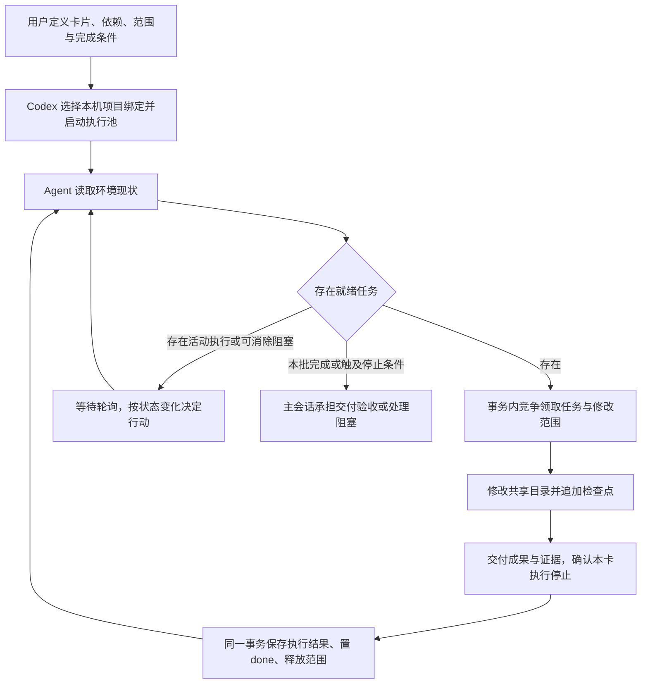

# Linear Lite 痕迹协作改造方案 V1

日期：2026-11-10。状态：方案稿，开发待启动。

采用“Linear Lite 保存协作事实，Agent 根据环境状态行动，Codex 宿主管理执行器”的方案。用户在看板卡中定义需求、依赖、执行范围和完成条件；Agent 通过读取、领取、修改与留痕推进任务，主会话承担目标管理、异常处理与交付验收。

## 1. 职责与事实归属

| 对象 | 职责与事实来源 |
|---|---|
| 用户 | 定义需求、选择参与协作的卡片、授权执行范围、处理业务决策 |
| Linear Lite | 保存项目目录绑定、任务、依赖、执行归属、租约、检查点和交付证据 |
| Agent | 读取环境、竞争领取任务、修改授权范围内的文件、记录发现与成果 |
| Codex 宿主 | 管理子代理槽位、设备身份、项目目录解析、续租、停止与恢复 |
| 主会话 | 管理目标、资源预算和停止条件，处理异常，承担交付验收 |
| 项目根目录 | 承载代码与执行环境 |
| 项目根目录下的 `docs/` | 承载协作约定、设计决策和说明材料，沿用项目文档分类 |

任务状态以 `tasks.status` 为准，执行事实以执行记录为准，公共约定以项目文档为准，代码以项目目录为准。禁止在 `docs/` 建立任务状态、领取权或租约的副本。

## 2. 用户、项目、设备与目录绑定

### 2.1 绑定关系

**一个用户、一个项目、一台设备，对应一条本机项目绑定记录。**

| 字段 | 含义与约束 |
|---|---|
| `id` | 绑定记录主键，执行记录通过该主键引用绑定 |
| `user_id` | 所属用户，由认证上下文确定 |
| `project_id` | Linear Lite 项目，用户具有项目访问权限 |
| `device_id` | 设备稳定标识，由宿主持久保存；主机名与 IP 地址作为展示信息 |
| `project_directory` | 该设备上的项目根目录，由宿主解析为规范化绝对路径后保存 |

唯一约束为 `(user_id, project_id, device_id)`。同一用户在两台设备使用同一项目，对应两条绑定记录；两台设备的项目目录允许不同。同一用户在同一设备绑定两个项目，对应两条记录。

`device_id` 用于设备识别，身份认证沿用用户授权机制。绑定访问校验用户归属与项目权限，执行宿主校验设备匹配和目录可用性。

### 2.2 一处目录配置

项目目录是该绑定记录中的唯一目录配置：

```text
用户 + 项目 + 设备
        │
        └── 本机项目绑定记录
                └── project_directory
                        ├── 代码与执行环境
                        └── docs/：协作资料
```

协作资料目录由 `project_directory` 拼接 `docs/` 得出。独立的工作区实体、共享根目录、协作资料目录配置排除在本版模型之外。宿主从绑定记录解析目录，服务端保存绑定事实与权限信息，文件执行发生在绑定设备。

绑定关系采用一条数据路径：绑定记录字段 → 服务 DTO → 前端绑定字段 → 宿主目录解析。现有目录配置入口改为维护该记录；旧项目目录映射从协作路径删除，禁止双读、双写与目录回退。绑定缺失、设备失配或目录不可访问时，执行停止并记录原因。

绑定目录变更、绑定删除或设备更换前，宿主停止该绑定下的活动执行并确认资源释放。宿主在启动阶段检查规范化物理根目录，拒绝该目录的第二个并发项目协作运行；该约束解决同一设备上不同绑定记录指向同一目录的冲突。

### 2.3 两种互斥范围

| 资源 | 互斥范围 |
|---|---|
| 任务领取 | 项目内的任务主键，覆盖用户与设备；同一任务在一个时刻归属于一个执行尝试 |
| 文件修改 | 本机项目绑定记录与规范化相对路径；同一绑定内的重叠修改范围互斥 |

两台设备具有各自的项目目录，但竞争同一个项目任务。不同设备上的代码与文档传输属于宿主交付职责：下游执行前取得前置成果，记录所采用的成果版本；成果缺失时记录阻塞原因，禁止将另一设备的本地路径当作可访问产物。V1 的单批协作使用一个本机项目绑定和同一共享目录，跨设备混合执行与代码同步排除在本版执行范围之外。

### 2.4 批次绑定约束

宿主启动本批执行前取得服务端签发的批次授权上下文，内容包含批次标识、认证用户、项目、固定绑定记录主键、卡片范围和有效期限。签发时校验用户、项目、绑定与设备归属；有效上下文内的绑定记录固定，切换设备或目录需结束本批并创建新批次。

查询、领取、续租、检查点和交付请求携带该上下文，服务端校验有效期、请求绑定与批次绑定一致、任务属于授权范围。执行记录保存批次标识与绑定主键。前置成果要求来自同一绑定，且成果在本批共享目录中可用；跨绑定成果禁止解锁 V1 下游任务。

批次上下文是有时限的执行授权，采用服务端签名校验，目录事实保持在本机项目绑定记录中。不同批次间的任务领取遵守项目级互斥，禁止通过更换批次标识绕过当前任务的有效领取或资源冻结。

## 3. 数据模型

### 3.1 任务扩展

| `tasks` 新字段 | 服务字段 | 用途 |
|---|---|---|
| `agent_execution_enabled` | `agentExecutionEnabled` | 用户授权该卡进入协作工作池，避免将人类待办纳入执行 |
| `input_revision` | `inputRevision` | 任务输入版本，需求、依赖、计划写入范围或上游成果失效时递增 |
| `write_scopes` | `writeScopes` | 计划修改的项目相对路径范围，包含代码与 `docs/` 中的待修改文件 |

需求描述、优先级、父子关系、业务状态和进度沿用任务字段。`assignee_key` 表达业务负责人，执行尝试表达当前执行实例的领取权，两者禁止混用。

协作执行与依赖以叶子卡为粒度。父卡承担需求分解与汇总；父子关系和前置依赖分开保存。

### 3.2 绑定、依赖与执行记录

| 存储对象 | 主要内容 |
|---|---|
| 本机项目绑定记录 | 用户、项目、设备、项目根目录；现有目录绑定入口按第 2 节改造 |
| 新增 `task_dependencies` | 当前任务主键、前置任务主键；关系去重，限制同项目，禁止自依赖与依赖环 |
| 新增 `task_execution_attempts` | 任务、批次标识、绑定记录、宿主与子代理实例、领取标识、输入版本、前置成果版本、租约、持有路径范围、执行状态、检查点、结果证据、停止原因与停止确认 |

每次领取生成一个执行尝试。重试创建新尝试，历史尝试保留。执行检查点按记录顺序追加，保留执行者、发生时间、发现、成果引用和阻塞原因；心跳更新租约，禁止用心跳替代业务检查点。

`tasks.write_scopes` 表达计划范围，执行记录中的范围快照表达本次持有权。执行结果保存产物与证据引用，业务完成状态保持一个来源。就绪、依赖阻塞和资源冲突由查询计算。

领取标识属于执行授权材料，禁止写入日志、项目文档、评论和检查点。凭据沿用认证通道管理。

## 4. 就绪条件与原子领取

Agent 在本批授权范围内查询工作。可领取任务满足以下条件：

1. 用户开启该卡的协作执行授权，卡片属于有效批次的选定范围，请求使用该批次固定的本机项目绑定。
2. 卡片为叶子任务，状态为 `todo`。
3. 前置任务处于 `done`，前置交付对应有效输入版本与本批绑定，成果在本批共享目录中可用。
4. 任务缺少有效领取和等待停止确认的执行尝试。
5. 计划修改范围与其他执行尝试持有的范围无冲突。

前置任务的 `canceled`、`duplicate` 和父卡汇总结果禁止充当前置成功证明。需求卡在进入工作池前写明完成条件，缺少完成条件的卡片列为待补充。

领取使用项目行作为短事务互斥点：锁定项目协调点，检查任务、依赖、输入版本及范围冲突，创建执行尝试，占用修改范围，将任务推进为 `in_progress`，提交事务。执行阶段释放数据库事务锁，保留执行记录中的资源归属。

REST、MCP、输入变更、依赖变更、交付及失效处理使用同一协调顺序与服务入口。普通任务更新的行锁无法代替领取条件。领取标识、租约和版本校验共同约束后续写入。

## 5. 痕迹协作流程



Agent 在领取前、跨任务行动前和提交成果前读取相关事实，内容包含任务输入版本、前置成果、公共约定、检查点及资源归属。各 Agent 保留各自的模型上下文，行动依据来自共享环境。

例如：任务 A 完成接口并留下代码、接口约定和交付证据；服务端保存结果并将 A 置为 `done`；任务 B 的依赖条件满足，空闲 Agent 在查询中发现 B 并竞争领取。A 与 B 之间省去进度通报，主会话省去逐卡派单。

驱动采用现状查询与轮询。状态提交后，查询即可发现后续工作；持久事件总线、MQ 和项目推送平台排除在本版范围之外。查询返回相关任务与成果引用，避免把全项目聊天记录装入每个 Agent 的上下文。

空闲、依赖等待、资源等待和失败具有不同含义。查询返回阻塞原因；宿主按任务耗尽、本批完成、预算耗尽、用户停止和需要业务决策等条件停止执行或交还控制，禁止用“本轮查询为空”推断完成。

## 6. 修改范围与资源归属

同一本机项目绑定内，互不重叠的文件修改允许并行，重叠文件或目录修改采用串行。路径按项目根目录解析，目录包含关系视为重叠；宿主校验符号链接解析后的目标归属，禁止通过路径别名绕过范围判断。

领取后的范围扩张通过同一原子服务申请。发生冲突时，Agent 记录阻塞原因并申请停止本次执行，停止确认后释放持有范围，按环境现状参与下一次领取，避免占用部分资源等待另一组资源。

Git 暂存与提交由宿主管理，防止不同卡片的修改混入同一提交。集成交付使用宿主划定的稳定检查点，相关执行证据引用该检查点。范围归属属于协作者协议，操作系统强制隔离排除在本版能力声明之外。

## 7. 完成与输入失效

### 7.1 完成命令

协作卡进入 `done` 的入口为完成命令。该命令校验用户与绑定权限、执行实例、领取标识、有效租约、输入版本、前置成果版本及交付证据；宿主确认该卡的写入动作与关联执行进程停止后，服务在同一事务中保存成功结果、调用任务状态服务并释放范围。

证据包含本卡完成条件对应的结果、修改位置、产物引用、采用的输入版本与项目检查点。协议校验保证证据归属和状态一致性，代码正确性由成果证据与交付验收承担。

任务普通更新、导入、进度 100% 和父卡汇总服从协作卡完成规则，禁止绕过完成命令。`tasks.status` 保持业务状态的唯一来源，执行尝试的成功或失败表达本次执行结果。

### 7.2 输入变更

需求、依赖、计划写入范围变化，或上游成果撤销时，在项目协调事务中递增受影响任务的 `input_revision`，沿依赖关系使旧成果失效：

- 当前任务及受影响下游中的完成卡回到 `todo`，等待符合新输入的交付。
- 活动执行进入停止流程，持有范围保留到停止确认。
- 旧版本成果提交遭拒，禁止解锁后续任务。
- 授权关闭、任务取消和项目权限撤销触发停止流程。

公共文档的指定版本作为任务输入引用；被引用的约定版本变化时纳入输入失效处理。前置成果与公共约定使用各自的来源版本，禁止使用修改时间推断版本一致性。

## 8. 租约、停止与恢复

宿主负责续租，避免把续租频率交给模型推理节奏。服务端以执行尝试、领取标识、输入版本和租约判断业务写入资格；旧尝试、失效版本和过期租约的业务写入遭拒。

**租约过期表示执行联系失效，资源释放以执行单元停止确认为条件。**

租约过期、输入失效或用户取消后，执行尝试记录停止原因并保留持有范围。宿主停止对应子代理及关联写入进程，使用绑定设备身份提交停止确认；服务端在同一项目协调事务中确认停止、释放范围并处理任务状态：

- 输入失效、租约过期或范围冲突导致停止，且任务授权与权限有效时，非终态卡回到 `todo`。
- 用户取消的卡片保留 `canceled`；执行尝试停止禁止恢复该卡的待执行状态。
- 执行故障保留失败原因；宿主按任务完成条件与预算决定是否申请新尝试，允许重试的非终态卡回到 `todo`。
- 授权关闭或权限撤销的卡片退出工作池，授权与权限恢复后经用户选择纳入新批次。

停止确认采用专用恢复操作，允许处理过期尝试；该操作保留用户、设备、绑定及尝试归属校验，禁止恢复过期尝试的业务写入权。宿主失联且无法确认停止时冻结资源，由恢复后的宿主或用户处理。

领取、检查点、交付和停止操作具有请求幂等标识。重复请求返回原操作结果，禁止重复创建尝试或重复推进状态；异步回报绑定执行尝试，禁止落入后续尝试。

## 9. 接口与前端边界

| 操作 | 输入重点 | 结果与约束 |
|---|---|---|
| 管理本机项目绑定 | 项目、设备、项目目录 | 用户身份来自认证；维护第 2 节唯一记录 |
| 观察协作环境 | 批次授权上下文、绑定记录 | 校验本批固定绑定，返回任务现状、就绪原因、阻塞原因、输入与成果引用 |
| 领取任务 | 批次授权上下文、绑定记录、宿主与子代理实例 | 校验绑定与卡片范围，原子创建尝试，返回领取结果与执行上下文 |
| 续租 | 批次授权上下文、执行尝试、领取标识 | 校验有效归属与租约后续期 |
| 追加检查点 | 批次授权上下文、执行尝试、领取标识、输入版本、事实与成果引用 | 追加执行痕迹，保留顺序与执行者 |
| 提交交付 | 批次授权上下文、执行尝试、领取标识、输入与成果版本、证据、停止确认 | 校验本批绑定与成果归属，执行统一完成规则，事务内保存结果与推进状态 |
| 请求停止与确认停止 | 执行尝试、原因、宿主停止事实 | 处理取消、失效和过期恢复，确认停止后释放范围 |

REST 与 MCP 共用服务，禁止为不同入口建立状态写入分支。MCP 复用用户认证与项目访问控制；共享登录身份下的不同子代理通过执行实例区分，实例标识无法替代认证。

前端沿用项目设置、看板和任务详情：设置中维护本机项目绑定，详情中展示依赖、协作授权、计划范围、执行归属、阻塞原因、检查点和交付成果。新字段沿“数据源字段 → DTO → 前端字段 → 业务使用点”传递；禁止字段别名回退与状态副本。

## 10. Codex 与 Pi 的集成边界

Codex 负责定时启动、填充执行槽位、关联执行实例、续租及停止确认。Agent 根据环境现状选卡，宿主根据槽位与预算维持执行池。北京时间 01:00 作为计划启动时间，运行持续时间以本批完成条件、预算及停止条件为准。

现有 Pi 的 `agent_task_sessions` 与 `agent_task_jobs` 保留人工提交指令的执行用途。Codex 协作执行使用 `task_execution_attempts`；两个模型记录各自的执行事实。行锁、幂等与租约模式可以复用，Pi 会话字段与执行凭据禁止作为 Codex 工作池的绑定配置。

公共文档沿用现有版本与幂等更新机制。任务活动服务承载界面活动记录，协作执行痕迹由执行记录保存。

本版交付边界包含绑定关系、任务输入、依赖、执行记录、统一状态服务、REST/MCP、现有界面接入和 Codex 宿主集成。宿主对设备标识、槽位生命周期、续租及执行停止确认的承载方式属于实施待落实项，禁止将服务端领取标识等同于本机进程控制能力。

## 11. 源码依据

以下位置对应方案检查时的工作区，基线提交为 `9df85ed`，包含用户现有未提交改动；方案中的新增字段与操作属于改造内容。

| 现有能力或缺口 | 源码位置 |
|---|---|
| 任务更新具有事务和行锁，缺少执行领取与输入版本前提 | `linear-lite-server/src/main/java/com/linearlite/server/service/TaskCommandService.java:151` |
| 状态、进度和完成时间具有统一写入服务 | `linear-lite-server/src/main/java/com/linearlite/server/service/TaskStatusService.java:24` |
| 进度 100% 联动完成 | `linear-lite-server/src/main/java/com/linearlite/server/service/TaskService.java:79` |
| 父任务按子任务终态汇总，终态包含取消和重复 | `linear-lite-server/src/main/java/com/linearlite/server/service/TaskHierarchyCompletionService.java:60`；`linear-lite-server/src/main/java/com/linearlite/server/mapper/TaskMapper.java:24` |
| 项目行互斥具有现有模式 | `linear-lite-server/src/main/java/com/linearlite/server/mapper/ProjectDocumentMapper.java:176` |
| Pi Job 领取限定用户与执行会话 | `linear-lite-server/src/main/java/com/linearlite/server/mapper/AgentTaskJobMapper.java:33` |
| Pi 采用绑定项目目录 | `pi-bridge/src/index.mjs:213` |
| Pi 回写归属校验缺少租约时间与领取代次约束 | `linear-lite-server/src/main/java/com/linearlite/server/service/AgentTaskOrchestrationService.java:374` |
| Pi 取消发送终止信号，缺少退出确认 | `pi-bridge/src/index.mjs:565` |
| 部分活动记录合并，现有活动查询覆盖状态和进度 | `linear-lite-server/src/main/java/com/linearlite/server/service/TaskActivityService.java:50` |
| 文档更新具备版本检查与请求幂等机制 | `linear-lite-server/src/main/java/com/linearlite/server/service/McpDocumentPatchService.java:49` |

方案整理完成，开发与宿主集成为待办项。
