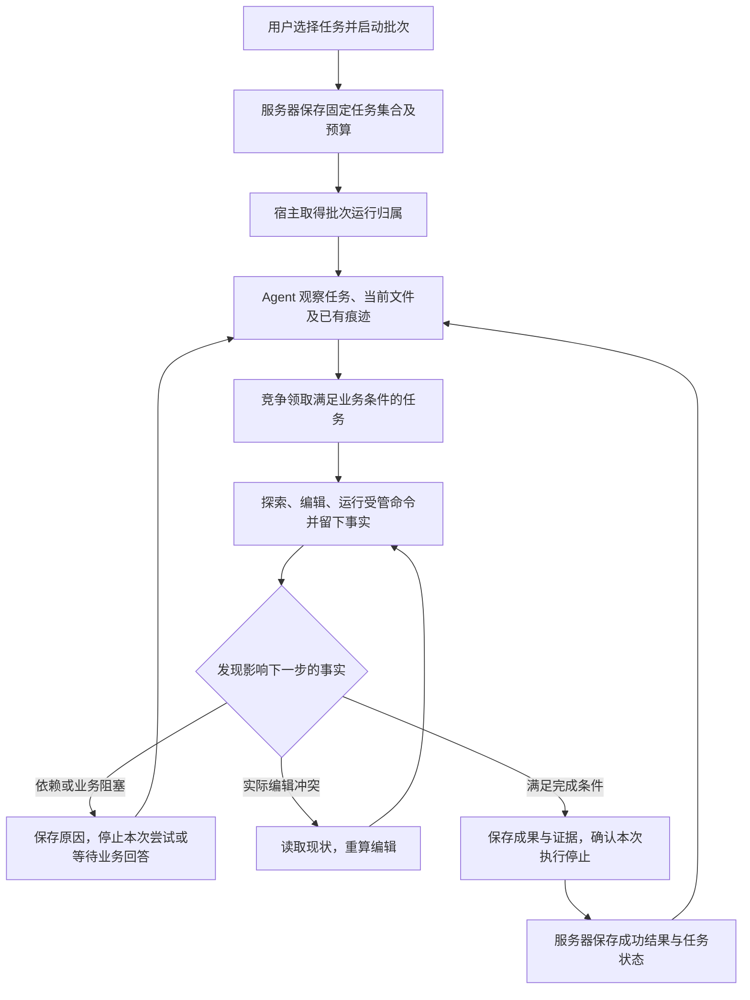

# Linear Lite 痕迹协作改造方案 V2

日期：2026-11-10。状态：待实施。

本版整合并取代《Linear-Lite痕迹协作改造方案V1》和《Linear-Lite痕迹协作网页控制方案V1》中的目标设计，两份 V1 保留为历史材料。

采用“用户授权目标，Agent 读取环境、领取任务、修改项目并留下事实，其他 Agent 根据事实行动”的协作方式。删除任务级写入范围、路径占有权、同目录批次排他和内部参数表单。Agent 共享绑定项目的工作目录，各模型会话的上下文保持独立。

## 1. 产品操作与授权

用户操作为：

1. 安装宿主、连接账号，在项目设置选择本机项目根目录。
2. 编写任务需求和完成条件，选择参与本轮的任务。
3. 确认执行设备、目录和运行时长，启动批次。
4. 查看执行、发现、成果和阻塞，停止批次，处理需要业务判断的问题。

确认启动构成本批固定任务集合的执行授权，沿用 `collaboration_batch_tasks`。删除任务上的 `agent_execution_enabled` 字段及“允许 Agent 执行”重复开关。任务取消、批次停止、设备授权撤销和项目权限变更沿现有通道撤回执行资格。

网页删除写入范围、前置任务搜索、公共约定选择、输入版本编辑、领取凭据和尝试次数表单。依赖、采用的约定、输入版本、尝试及协议标识由 Agent、宿主和服务器维护。并发数和尝试预算采用系统默认值及服务端上限，启动面板展示预算结果；用户设置运行时长与停止意图。

前置任务属于内部协作事实，用户不承担指定任务顺序、填写依赖表或确认依赖图的工作。启动、阻塞处理和恢复入口禁止把前置任务编号或关系配置作为用户必填项。

业务需求不足时，Agent 留下问题及影响，用户回答业务问题。文件清单、任务数字主键、文档版本和租约参数排除在补充需求之外。

## 2. 用户、项目、设备与共享目录

**一个用户、一个项目、一台设备，对应一条绑定记录**，保持 `(user_id, project_id, device_id)` 唯一约束。

| 对象 | 含义 |
|---|---|
| 用户 | 认证账号；项目访问与执行操作服从项目权限 |
| 项目 | Linear Lite 项目及其任务和文档 |
| 设备 | 宿主持久标识，设备名称用于展示；标识不充当认证凭据 |
| `project_directory` | 该设备上的项目根目录，是绑定的目录配置 |
| 项目根目录下的 `docs/` | 协作材料，沿用项目中的分类目录 |

协作资料目录由项目根目录派生。独立共享根目录、第二套项目目录映射和按任务创建的 worktree 排除在本方案之外。

单个批次固定一个绑定及其版本；同一物理项目目录允许多个批次和多个 Agent 工作。宿主以物理根识别共享环境，用于汇集变更事实；该标识不提供排他占有权。不同设备的目录、工作树和产物各自存在，跨设备混合执行及代码同步排除在本版范围之外。

项目授权边界覆盖根目录中的代码、配置和资料，任务无需预报会修改哪些文件。宿主私有状态、凭据、系统目录和项目外目录受执行器保护；符号链接、路径别名和硬链接不得绕过项目边界。项目内目录划分不参与任务调度或写权限计算。

目录变更或删除绑定时，停止被变更绑定的活动执行并确认退出；其他绑定的执行保持原归属。绑定配置变更不移动或覆盖物理目录。物理根被替换时，受到影响的执行根据目录身份检查进入停止流程。该约束保护运行中的目录身份，不限制任务并发修改文件。

## 3. 现有实现与改造点

以下为本机工作区源码事实，目标行为见后续章节。

| 现有链路 | 改造 |
|---|---|
| `TaskCollaborationSettings.vue` 收集授权、范围、前置任务和文档版本，调用全量输入替换 | 移除配置表单，改为执行事实、发现、依赖原因及成果展示 |
| `TaskCollaborationInputService.replaceInputs` 要求范围等字段，变更后递增版本并失效下游 | 删除旧全量配置入口，分离需求变更、依赖变更与上下文读取事实 |
| `TaskCollaborationClaimService.evaluate/claim/expand` 计算范围重叠、等待和范围扩张 | 删除范围校验、占用、扩张和冲突等待；保留任务领取权、版本和依赖事实 |
| 批次详情及任务状态服务重复计算范围冲突 | 删除相同路径上的计算及前端显示 |
| `executor.mjs` 按 `writeScopes` 拒绝文件操作，全文件截断后写入 | 改为项目级受管编辑，针对实际编辑上下文处理冲突 |
| `root-lease.mjs` 以物理目录建立批次独占锁；`batch-driver.mjs` 按活动目录去重 | 删除目录排他，运行恢复资料按批次及执行代次保存 |
| `checkpointAvailable` 比较当前文件与旧快照的全部内容 | 取消旧快照与当前文件相等的就绪门槛，保留历史产物与证据 |
| `pool.mjs` 没有网页项目文档读取和依赖维护工具 | 增加宿主操作，复用服务端文档、依赖和权限服务 |
| app-server 的普通命令运行在只读环境 | 保留该隔离，补充宿主侧受管项目命令，承载构建、测试和依赖处理 |

## 4. 事实归属与数据调整

| 事实 | 唯一来源与使用方式 |
|---|---|
| 需求、完成条件、业务状态 | `tasks`；执行输入版本使用 `input_revision` |
| 本批执行授权 | `collaboration_batches` 与 `collaboration_batch_tasks` 的用户选择和运行意图 |
| 账号、设备授权和心跳 | `host_device_authorizations`，保持 OAuth 与 PKCE、钥匙串和撤销机制 |
| 用户、项目、设备、目录 | `project_device_bindings`，固定绑定主键及版本传入批次 |
| 当前前置依赖 | `task_dependencies`，由 Agent 按事实维护，并记录建立或撤销原因 |
| 执行归属、租约、停止事实 | `task_execution_attempts`，保留批次、绑定、宿主、Agent 和执行代次关联 |
| 发现、上下文读取、成果和阻塞 | 执行检查点与结果证据，按尝试保存；环境查询提供项目内授权可见的投影 |
| 当前代码与本地资料 | 项目文件；`docs/` 保存方案和约定，不保存任务状态或租约副本 |
| 文件操作及本机恢复事实 | 宿主私有操作记录、执行及进程组 journal；网页摘要来自服务端回执 |

删除 `tasks.write_scopes`、`task_execution_attempts.held_write_scopes`、`tasks.agent_execution_enabled`。删除 `tasks.public_context_refs` 的预配置语义与字段；实际采用的约定进入执行检查点和交付证据的 `contextRefs`，不要求任务配置引用清单。

`contextRefs` 使用来源判别字段：项目文档引用记录文档主键与文档版本；本地资料引用记录项目相对路径与宿主读取内容的版本。按来源分型校验，不建立多键回退。网页文档版本来自文档服务字段，本地内容版本由宿主文件读取产生并核验，不使用任务输入版本或文件修改时间代替。服务器无法访问本机文件，宿主离线或缺少核验事实时显示“待确认”。网页文档内容由现有文档服务提供，本地资料由项目文件提供，不复制成第二套公共文档库。

`changedPaths` 保留，含义为实际变更记录。其产生时间在文件操作之后，不参与授权、领取、调度、独占或扩大写权限。宿主从受管编辑和命令事实生成记录，Agent 的描述不能替代文件变更事实。共享目录的总 diff 展示环境变化，不归作某张任务的私有改动。

字段沿“来源事实 → 服务 DTO → 前端字段 → 展示或执行使用点”传递。历史检查点及结果原文保留作审计，取消旧字段推断和双读双写；旧范围记录不转成新权限。

## 5. 任务推进与痕迹协作

领取条件为：有效批次授权、项目及设备权限、任务属于本批集合、任务处于可执行业务状态、需求版本有效、已知前置具有同绑定的有效交付事实、该任务缺少活动或待恢复的旧尝试。交付待复核与交付缺失分开处理，规则见第 6.3 节。叶子任务粒度沿用现有实现，父子关系表达需求分组。父子关系不生成前置依赖。

项目协调行的数据库短事务保留，用于任务领取、状态和输入变更的一致性。事务提交后释放数据库锁；任务执行期间不占有项目、文件或目录。一次有效尝试拥有任务执行权，其他任务使用相同文件不构成领取阻塞。

Agent 在行动前读取相关事实、处理实际冲突、记录发现并提交成果。其他 Agent 通过环境查询及当前文件获取变化，省去点对点汇报。宿主使用现有轮询驱动空闲槽位；单次空查询不代表完成。任务耗尽、依赖等待、设备离线、预算耗尽、业务问题和用户停止分别返回原因。MQ、消息总线、逐卡人工派发和固定“规划审批阶段”排除在本版之外。

## 6. 依赖与公共约定由 Agent 维护

### 6.1 前置关系

Agent 观察共享环境中的成果、接口、文件和阻塞，判断当前工作需要什么条件。缺少条件时留下“缺少什么、判断依据、满足条件的证据”，成果出现后根据环境变化继续行动。依赖关系是这些观察形成的内部记录，不要求用户或规划 Agent 在执行前列完任务图。

Agent 从需求、代码及成果发现前置关系，建立关系时提交原因和依据。服务端保留同项目、去重、自依赖、依赖环及执行资格校验。对已领取任务的关系修改，需要该尝试的有效执行归属和读取版本；禁止 Agent 改写其他执行者的任务协作输入。

依赖关系改变领取语义：在同一协调事务中更新关系、递增受影响输入版本并提交旧尝试的停止意图。宿主封存该尝试，完成停止确认，再按新条件领取。重复提交相同关系返回原结果，不递增版本。关系撤销遵守相同规则，循环依赖或错误判断形成可读原因，不要求用户编辑依赖编号。

缺少前置关系不会触发强制规划流程，Agent 可以开始探索。发现缺少成果时再形成依赖和阻塞。前置任务在本批集合内时，空闲 Agent 根据就绪事实领取。所需工作属于当前授权目标时，Agent 在任务中解决，禁止要求用户补建前置卡或填写依赖。涉及授权集合外的新业务目标时，网页说明目标及影响，由用户决定是否授权；任务匹配与依赖记录由系统完成。Agent 无权扩大原批次的任务授权集合，新增目标经授权后进入新批次。

### 6.2 上下文与约定

Agent 读取项目说明、`docs/` 和网页项目文档，记录采用的内容、来源及版本。宿主提供本地文件读取与网页文档发现、读取操作，后者复用现有文档服务和项目权限。普通文件的读取不等于公共约定，采用关系由执行痕迹说明。

首次读取或采用约定是执行事实，进入当前尝试的检查点；不改变任务输入版本，不触发自我停止。约定内容变化时，查询依据消费引用标记关联证据待复核，Agent 读取新内容，处理对当前工作和已交付成果的影响。需求、完成条件或前置关系的业务变化沿输入失效机制处理，读取行为与业务输入变更分开。

旧成果可供查阅，不能仅凭任务 `done` 或旧文件路径认定下游要求满足。下游结合前置交付、当前代码和所需约定判断可用性，并记录采用依据；具体不一致形成复查或修复事实。当前文件经过后续合法修改，不触发“与旧快照不等即永久不可用”的规则。

### 6.3 待复核成果的推进路径

前置存在同绑定、有效任务输入版本和停止确认的成功交付事实时，当前内容变化、产物缺失或本机可用性待确认均属于待复核原因，下游保持领取资格。观察响应标出复核原因，下游 Agent 在自己的有效尝试中读取当前内容或取得产物缺失事实，形成关联前置尝试、来源版本、判断和依据的复核记录；满足要求时形成采用记录。

复核满足下游要求时，采用记录解除本次尝试的复核待办，Agent 继续执行；不修改上游历史结果，不伪造上游重交付。复核发现问题且修复属于当前任务目标时，Agent 在本次尝试中修复并补充证据。完成命令校验采用记录的尝试归属、引用版本和结论；缺少采用依据或发现新的相关变化时拒绝旧证据。

前置成功交付事实缺失或任务输入失效时，进入不可领取的依赖等待。复核确认前置产物缺失或修复超出下游任务目标，且上游属于本批授权集合时，领域服务根据有效复核记录使对应交付失效，将上游转为 `todo` 并使受影响下游输入失效；宿主收口旧尝试后，上游取得返工领取资格。该操作校验复核者的当前执行归属、前置关系、来源尝试及其版本，沿项目协调事务幂等处理；来源成果被新版本取代时拒绝旧复核，要求读取现状。Agent 提交复核事实，不通过普通任务更新改写其他任务的协作输入。

需要执行授权集合外的工作时，进入第 6.1 节的业务纳入流程。尝试因具体阻塞停止时留下阻塞对象及事实版本，相同事实下不通过重复领取耗尽预算；相关成果、内容或用户业务输入变化后恢复候选资格。缺少待领取下游时，历史成果保留待复核标记，不触发模型运行。依赖等待不免除服务器预算和截止时间，预算耗尽按原批次规则结束。

## 7. 共享编辑、命令与实际冲突

### 7.1 编辑通道

复用宿主受管写入通道，增加 `read_file`、`apply_patch`；文件创建、删除及重命名进入相同通道。创建以目标不存在为条件，删除及覆盖携带读取时的内容依据，局部编辑携带原文上下文。实际应用时校验现状，歧义或变化返回冲突与原因，Agent 重读并重算。

宿主保证经该入口的单次校验与落盘的一致性；关键段覆盖实际编辑操作，结束即释放，不跨模型回合、命令、任务或租约持有文件权。两个任务可以修改同一个文件、同一个目录，调度器不因路径重叠拦截任务。

删除现有无读取条件的全文件截断写入。内容变化后的编辑禁止覆盖新现状，禁止用等待某路径所有者的方式解决冲突。项目物理目录身份、项目外跳转、私有状态和凭据保护保留；其检查不携带任务路径清单。

### 7.2 受管命令

app-server 的普通命令保持只读隔离；宿主提供项目级可写命令操作，支持构建、测试、依赖处理及项目生成工具。命令无需申报文件清单，通过宿主侧项目执行沙箱限制文件系统边界，登记执行尝试、进程组、超时、起止事实和输出摘要。无约束宿主 `spawn` 加工作目录不能充当沙箱实现。

命令沿用同一批次预算、尝试租约和停止门禁。项目级沙箱允许绑定项目中的写入及受管临时空间，保护宿主凭据和项目外位置；项目外部署、系统修改及外部系统写操作不从项目授权中派生。支持前台构建和测试进程，后台守护与脱管执行排除在命令契约之外。

命令不占有路径，不阻止其他任务编辑相同文件。命令与外部编辑器可能在编辑操作之外修改文件，不能宣称此类写入享有宿主编辑入口的冲突保证。检测到变化时，后续编辑重读现状，相关验证证据标为待复核。

### 7.3 变更与成果

宿主在操作后留下文件变更和命令事实，关联执行尝试；文件通知用于提示变化，内容现状和操作记录用于判断结果。受管编辑有操作级归属；并发命令前后 diff 表达环境差异，不能归作该命令任务的全部改动。命令记录自身执行、能确认的产物和归属不明的变化，后者不写成该任务的确定 `changedPaths`。记录失败或命令结果未知时保留未知状态，不虚构任务归属和验证成功。

验证证据引用运行时的输入、采用内容、命令及输出。命令期间发生并发修改时标明影响，Agent 根据完成条件复查。共享可变目录中的检查结果不表示全项目处于稳定版本。

检查点保存历史产物和操作证据，不回写旧文件覆盖共享目录，不作为路径所有权证明。Git 状态和 diff 用于展示现状，宿主不按任务对全仓暂存、提交或清理；提交按用户授权处理并保留其他任务及用户改动。

## 8. 批次归属、停止与恢复

删除物理根锁及同目录批次去重，替换为按 `batchId + runEpoch` 管理的本机运行 journal。宿主单实例属于设备服务归属，同一批次的接受、续租及恢复沿用服务端运行代次；二者不产生目录排他权。

批次运行权、任务领取权、停止和恢复资料继续持久保存。停止流程为：保存停止意图 → 拒绝该尝试的新编辑和命令 → 排空在途编辑 → 结束登记进程组 → 提交停止确认 → 服务端结束对应尝试与批次。停止一个尝试不封存其他任务的写入通道。

租约过期、断网、睡眠和授权撤销不能证明进程退出。旧尝试在停止确认前保持待恢复，禁止同一任务被新尝试接管；其他独立任务保持执行资格。存在无法确认退出的写入进程时，工作区显示待恢复及结果可信性提示，执行不能把该现场视为干净结果。恢复阻塞绑定该尝试及其任务，不按目录冻结其他任务。

进程证明覆盖登记的托管进程组，外部编辑器和主动脱离进程组的任意后代不属于该证明范围；禁止将 `sealAndDrain` 描述为对所有系统进程的写入撤销。归属或退出事实不明时保留恢复资料，网页不给出“强制解锁路径”的入口。

绑定目录变更、安装、升级及卸载入口改为检查运行 journal 和待恢复尝试，不读取旧根锁判断运行资格。预算、截止时间、幂等请求和重试结果保持现有语义；刷新网页、网络恢复及宿主重启不重置预算。后台保活与协作定时触发分开，定时任务保持关闭。

## 9. 接口与页面调整

REST、MCP 与宿主工具复用服务端领域服务和权限控制。

| 入口 | 目标行为 |
|---|---|
| 任务详情 | 需求编辑及执行事实；展示发现、依赖原因、采用的约定、实际改动、结果和阻塞 |
| 批次启动 | 用户选择任务、设备及运行时长；服务器生成预算、标识和固定授权集合 |
| 环境观察 | 返回授权任务及项目内可见痕迹、前置成果和当前阻塞，不返回路径资源持有者 |
| Agent 依赖维护 | 校验本任务执行归属、读取版本、关系及原因，幂等更新并触发输入失效 |
| 前置成果复核 | 保存下游采用依据；确认失效时由领域服务校验来源并使本批授权上游返工 |
| 文档发现及读取 | 复用项目文档读取服务，返回真实文档版本，宿主记录采用事实 |
| 本地文件及命令 | 由绑定设备宿主执行，提供项目级编辑、受管命令、实际冲突与执行事实 |
| 完成 | 校验归属、版本、成果、完成条件及停止事实，保存结果并推进任务状态 |
| 停止及恢复 | 复用用户操作和归属受限的恢复通道，不要求网页持有领取凭据 |

删除 `replace_task_collaboration_inputs` 的旧全量配置契约和 `expand_collaboration_write_scopes` 操作。普通任务更新保留业务输入版本控制，内部依赖维护使用专用尝试命令。读模型展示 `inputRevision` 等追踪信息时使用详情，不把版本冲突转成“加载服务器版本”配置作业。

移除路径冲突产生的 `RESOURCE_WAIT`；任务被其他尝试执行、依赖缺失、预算不足和停止待确认使用各自业务原因。空依赖、空采用记录和空实际改动不代表配置不完整；只读分析任务可凭需求对应的结果交付，不要求伪造修改文件。

## 10. 删除、复用与新增清单

| 处理 | 对象 |
|---|---|
| 删除 | 任务及执行记录中的写入范围字段；范围规范化、重叠、扩张、占用与完成时范围包含校验 |
| 删除 | 任务全局执行开关、预填公共约定列表、旧全量输入替换契约及前端编辑状态 |
| 删除 | `root-lease.mjs` 的物理目录排他、池启动根锁、批次驱动同目录去重及“范围释放”状态 |
| 删除 | 当前文件必须与旧检查点相等的依赖门槛、路径资源所有者投影和范围相关文案 |
| 复用 | 项目绑定、OAuth/PKCE、钥匙串、宿主安装后台服务、持久批次、任务领取与租约 |
| 复用 | 幂等操作、检查点、任务状态与输入失效、进程组 journal、停止确认和归属受限恢复 |
| 增补 | Agent 依赖维护和项目文档读取操作、上下文采用事实、受管编辑及项目命令、按批次运行 journal |

受影响代码覆盖前端组件、API 类型与映射、任务 store、批次及任务状态投影；服务端实体、DTO、Mapper、输入/领取/完成/生命周期/恢复服务、REST/MCP 操作目录；宿主工具、执行池、命令进程组、检查点、批次驱动、恢复与安装器。

`CollaborationPathScopeService` 的范围能力删除。成果相对路径校验归入项目产物引用校验，不保留路径权限服务外壳。历史测试、安装资源和说明中的范围契约随实施更新，避免旧调用残留；本方案不编写或执行这些改动。

## 11. 切换顺序

1. 形成上述领域服务、网页和宿主的一组新协议产物；任务集合授权、依赖命令和上下文事实走单一数据路径。
2. 切换前停止接受旧批次，完成活动及待恢复执行的收口，备份数据库、历史证据和服务器配置。原根锁存在且未完成停止确认时保留现场，不能通过删除锁文件完成切换。
3. 通过 DBX 执行所需结构调整，增量脚本归档至 `schema.sql`；删除字段前保存原数据，移除创建旧字段的脚本片段。历史结果原文保留审计，新协议不从旧配置推断实际采用记录。
4. 网页、服务器与宿主按同一协议版本切换；旧宿主拒绝领取新协议批次并显示升级入口，新服务不接收旧范围契约，不增加兼容分支或双协议执行链。
5. 安装器和恢复入口使用新运行 journal，确认切换完成后移除退出使用的旧根锁目录及代码。批次保持等待用户启动，定时触发保持关闭。

数据库恢复、应用回滚和旧宿主恢复遵循同一备份边界，禁止将旧程序连接到删除字段后的结构。切换及回滚均保留用户配置和业务历史，不回写项目文件现场。

## 12. 源码定位

以下位置对应本版检查时的工作区，实施后行号会变化。

| 证据 | 位置 |
|---|---|
| 内部参数表单与输入替换 | `src/components/TaskCollaborationSettings.vue:61、177、247`；`src/services/api/taskCollaboration.ts:7` |
| 必填字段及依赖/引用校验 | `linear-lite-server/src/main/java/com/linearlite/server/service/TaskCollaborationInputService.java:80、163、191` |
| 领取时保存范围及路径重叠等待 | `linear-lite-server/src/main/java/com/linearlite/server/service/TaskCollaborationClaimService.java:82、137、214、235` |
| 完成时范围包含校验 | `linear-lite-server/src/main/java/com/linearlite/server/service/TaskCollaborationCompletionService.java:39、65` |
| 批次固定任务集合及重复授权 | `linear-lite-server/src/main/java/com/linearlite/server/service/CollaborationBatchControlService.java:100、105、131` |
| 状态服务路径冲突 | `linear-lite-server/src/main/java/com/linearlite/server/service/TaskCollaborationStateService.java:72`；`CollaborationBatchControlService.java:229、297` |
| MCP 旧输入及范围扩张 | `linear-lite-server/src/main/java/com/linearlite/server/service/CollaborationApiService.java:162、192` |
| 任务、执行记录与持久批次字段 | `linear-lite-server/src/main/resources/schema.sql:246、366、385、419` |
| 范围门禁、全文件写入与封存 | `codex-host/src/executor.mjs:14、35、64、81、113` |
| 根目录排他与恢复 | `codex-host/src/root-lease.mjs:8、15、92`；`codex-host/src/pool.mjs:38、46` |
| 目录批次去重 | `codex-host/src/batch-driver.mjs:58` |
| 模型工具、领取、完成和写入事实 | `codex-host/src/pool.mjs:13、190、239、247、253、341` |
| 原生只读沙箱与工具隔离 | `codex-host/src/app-server.mjs:13、132、168、185` |
| 历史快照与当前文件相等门槛 | `codex-host/src/checkpoint.mjs:28、81` |
| 进程组停止证明与安装阻止条件 | `codex-host/src/process-groups.mjs:52`；`codex-host/install/manager.mjs:103、195` |

本轮产物为本方案文档。代码、数据库、部署、真实模型执行及定时任务均不在本轮执行范围。
