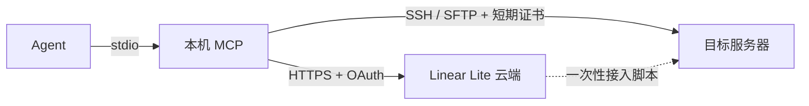

# 远程运维 MCP 团队版方案 V1

在 V4 本机方案基础上，把目标与身份配置收归 Linear Lite 云端，按项目共享；登录凭据改为云端 SSH CA 签发的短期证书。SSH 流量仍由本机 MCP 直连目标服务器，云端不经手命令与输出。

## 1. 目标与边界

目标：

- 一个 Linear Lite 项目对应一套服务器配置，成员无需各自维护 `targets.json`。
- 成员入离职、权限变更只在云端操作，不需要逐台修改服务器。
- 服务器上不再存放成员个人公钥。
- 可追溯谁在什么时间为哪台服务器、哪个账号申请了登录证书。

不在本期范围：

- 云端中继、堡垒机、会话录像、命令级审计与审批。
- 吊销列表（KRL）分发。本期依靠短有效期失效。
- 主机证书（host CA）。主机身份仍用固定 host_key。
- 独立账号体系与计费。

## 2. 总体结构



| 组件 | 职责 |
| --- | --- |
| Linear Lite 云端 | 保存目标、身份、授权、主机公钥；保管项目 CA 私钥并签发证书；记录签发与配置变更日志；提供管理页面 |
| 本机 MCP | OAuth 登录；拉取目录；会话内生成临时密钥并申请证书；校验 host_key；SSH 直连；工具契约与 V4 一致 |
| 目标服务器 | 信任项目 CA 公钥；按 principal 映射登录账号 |

云端持有的是签发能力，不持有长期登录私钥；本机临时私钥只存在于 MCP 进程内存，不落盘，不出进程。

## 3. 信任模型

| 资产 | 位置 | 泄露后果 | 缓解 |
| --- | --- | --- | --- |
| 项目 CA 私钥 | 云端，KEK 加密存库 | 可签发该项目任意 principal 证书，登录所有接入服务器 | KEK 不入库；签发只走服务端代码；轮换流程；每台服务器只接受本机 principal |
| 用户 OAuth 令牌 | 本机用户目录，0600 | 在授权范围内申请证书 | 令牌短期 + refresh；云端可撤销；签发日志可查 |
| 单张证书 + 临时私钥 | MCP 进程内存 | 有效期内登录单个 target 的单个账号 | 有效期 ≤ profile.max_ttl_seconds；principal 绑定 target |
| host_key | 云端 + 本机 pin | 云端被篡改可引导连接到伪造主机 | 本机 pin；变化时拒绝连接，需人工确认 |

关键约束：证书 principal 形如 `rt.<project>.<target_id>.<login_user>`，每台服务器的 principals 文件只列出属于它自己的 principal。因此一张证书只能登录一台服务器的一个账号，即使 target 配置被改错，也不能把 A 机的证书用于 B 机。

## 4. 云端设计

### 4.1 权限

团队即 Linear Lite 项目，沿用 `project_members`：

- 项目 `owner`：管理目标、身份、授权，轮换 CA，查看全部日志。
- 普通成员：只能看到并使用被授权的 target/profile，查看自己的签发记录。

授权粒度为 `(target, profile, user)`。不做环境级通配；新增 target 后需要显式授权，防止 prod 随新机器自动扩散。

### 4.2 数据表

```sql
-- 每项目一把活动 CA，轮换期间允许两把同时有效。
CREATE TABLE rt_ca_keys (
  id               BIGINT PRIMARY KEY AUTO_INCREMENT,
  project_id       BIGINT       NOT NULL,
  public_key       VARCHAR(512) NOT NULL COMMENT 'OpenSSH ssh-ed25519 公钥文本',
  private_key_enc  VARBINARY(512) NOT NULL COMMENT 'AES-256-GCM(KEK) 密文，含 nonce',
  status           VARCHAR(16)  NOT NULL COMMENT 'active | retiring | retired',
  created_at       DATETIME     NOT NULL DEFAULT CURRENT_TIMESTAMP,
  KEY idx_rt_ca_project (project_id, status)
);

CREATE TABLE rt_targets (
  id            BIGINT PRIMARY KEY AUTO_INCREMENT,
  project_id    BIGINT       NOT NULL,
  target_id     VARCHAR(100) NOT NULL COMMENT '与 V4 target_id 相同约束',
  alias         VARCHAR(256) NOT NULL,
  environment   VARCHAR(256) NOT NULL,
  host          VARCHAR(256) NOT NULL,
  port          INT          NOT NULL,
  host_key      TEXT         NOT NULL COMMENT '经核对的 OpenSSH 主机公钥',
  host_key_rev  INT          NOT NULL DEFAULT 1 COMMENT 'host_key 每次变更 +1',
  deleted_at    DATETIME     NULL,
  UNIQUE KEY uk_rt_targets (project_id, target_id)
);

CREATE TABLE rt_profiles (
  id               BIGINT PRIMARY KEY AUTO_INCREMENT,
  target_ref       BIGINT       NOT NULL COMMENT 'rt_targets.id',
  profile_id       VARCHAR(100) NOT NULL,
  login_user       VARCHAR(256) NOT NULL,
  max_ttl_seconds  INT          NOT NULL COMMENT '1–28800',
  permit_pty       TINYINT      NOT NULL DEFAULT 1,
  deleted_at       DATETIME     NULL,
  UNIQUE KEY uk_rt_profiles (target_ref, profile_id)
);

CREATE TABLE rt_grants (
  id           BIGINT PRIMARY KEY AUTO_INCREMENT,
  profile_ref  BIGINT   NOT NULL,
  user_id      BIGINT   NOT NULL,
  granted_by   BIGINT   NOT NULL,
  created_at   DATETIME NOT NULL DEFAULT CURRENT_TIMESTAMP,
  UNIQUE KEY uk_rt_grants (profile_ref, user_id)
);

-- 签发记录；serial 即证书序列号。
CREATE TABLE rt_certificates (
  serial          BIGINT PRIMARY KEY AUTO_INCREMENT,
  project_id      BIGINT       NOT NULL,
  ca_ref          BIGINT       NOT NULL,
  user_id         BIGINT       NOT NULL,
  target_ref      BIGINT       NOT NULL,
  profile_ref     BIGINT       NOT NULL,
  principal       VARCHAR(512) NOT NULL,
  key_fingerprint VARCHAR(128) NOT NULL COMMENT '临时公钥 SHA256 指纹',
  valid_after     DATETIME     NOT NULL,
  valid_before    DATETIME     NOT NULL,
  client_ip       VARCHAR(64)  NOT NULL,
  oauth_client_id VARCHAR(128) NOT NULL,
  created_at      DATETIME     NOT NULL DEFAULT CURRENT_TIMESTAMP,
  KEY idx_rt_cert_project_time (project_id, created_at),
  KEY idx_rt_cert_user_time (user_id, created_at)
);

-- 目标、身份、授权、CA 的变更日志，before/after 不含私钥。
CREATE TABLE rt_audit_events (
  id          BIGINT PRIMARY KEY AUTO_INCREMENT,
  project_id  BIGINT      NOT NULL,
  actor_id    BIGINT      NOT NULL,
  action      VARCHAR(64) NOT NULL,
  subject     VARCHAR(256) NOT NULL,
  before_json JSON        NULL,
  after_json  JSON        NULL,
  created_at  DATETIME    NOT NULL DEFAULT CURRENT_TIMESTAMP,
  KEY idx_rt_audit_project_time (project_id, created_at)
);
```

删除 target/profile 使用软删除，保留签发记录的关联。删除 profile 时级联删除其授权。

### 4.3 CA 与签发

- 算法：CA 与临时密钥都只用 Ed25519。JDK 17 自带 Ed25519 签名，不新增依赖。
- CA 私钥：创建项目 CA 时在服务端生成，以环境变量 `RT_CA_KEK`（32 字节 Base64）做 AES-256-GCM 加密后入库。KEK 缺失时远程终端功能整体不可用，不降级为明文。私钥不写日志、不出 API。
- 证书编码：服务端实现 OpenSSH `ssh-ed25519-cert-v01@openssh.com` 编码（约 150 行），用 `ssh-keygen -L` 和真实 sshd 做测试。

签发内容：

| 字段 | 值 |
| --- | --- |
| type | user |
| serial | `rt_certificates.serial` |
| key id | `u<user_id>/<project>/<target_id>/<profile_id>` |
| principals | 仅一个：`rt.<project>.<target_id>.<login_user>` |
| valid after | 当前时间 − 60 秒（容忍时钟偏差） |
| valid before | 当前时间 + min(请求 ttl, profile.max_ttl_seconds) |
| critical options | 无 |
| extensions | 仅 `permit-pty`（profile.permit_pty=1 时）；不含 port/agent/X11 forwarding 与 user-rc |

签发前在同一事务中校验：用户仍是项目成员、授权存在、target/profile 未删除、项目 CA 为 active。

### 4.4 接口

客户端接口使用 OAuth 访问令牌，新增 scope `remote-terminal`；现有 `linear-lite:read/write` 令牌不能调用这些接口，反之亦然。

| 方法 | 路径 | 说明 |
| --- | --- | --- |
| GET | `/api/remote-terminal/catalog?project=<identifier>` | 返回当前用户被授权的 targets 与 profiles，含 host_key、host_key_rev；响应带 ETag |
| POST | `/api/remote-terminal/certificates` | 请求 `{project, target_id, profile_id, public_key, ttl_seconds}`；返回 `{certificate, serial, valid_before}` |

目录响应结构与 V4 `Configuration` 对齐，profile 不含本机路径：

```ts
type Catalog = {
  project: string;
  targets: Array<{
    target_id: string; alias: string; environment: string;
    host: string; port: number; host_key: string; host_key_rev: number;
    profiles: Array<{ profile_id: string; login_user: string; max_ttl_seconds: number }>;
  }>;
};
```

管理接口沿用现有 Web 登录态，仅项目 owner 可调用：target、profile、授权的增删改查；CA 创建与轮换；接入脚本下载；签发记录和变更日志查询。

签发接口按用户限流，默认每分钟 30 次，防止失控的 Agent 循环申请。

### 4.5 管理页面

在项目设置下新增“远程终端”分组：

- 服务器：列表与编辑，host_key 必须粘贴完整公钥，页面显示 SHA256 指纹供核对。
- 身份与授权：按 target 展开 profile，勾选成员。
- 接入：显示 CA 公钥与接入脚本。
- 记录：签发记录（按人、按服务器筛选）与配置变更日志。

## 5. 服务器接入

owner 在页面上为某个 target 生成接入脚本，用已有方式（现有 SSH 账号或控制台）在服务器上以 root 执行一次。脚本内容是明文 shell，可先审阅：

```bash
install -d -m 755 /etc/ssh/linear-lite
# 项目 CA 公钥，轮换期间可有两行
cat > /etc/ssh/linear-lite/user_ca.pub <<'EOF'
ssh-ed25519 AAAA... linear-lite ENG
EOF
install -d -m 755 /etc/ssh/linear-lite/principals
# 每个登录账号一个文件，只列出本机 principal
echo 'rt.ENG.prod-api-1.deploy' > /etc/ssh/linear-lite/principals/deploy
cat > /etc/ssh/sshd_config.d/60-linear-lite.conf <<'EOF'
TrustedUserCAKeys /etc/ssh/linear-lite/user_ca.pub
AuthorizedPrincipalsFile /etc/ssh/linear-lite/principals/%u
EOF
sshd -t && systemctl reload sshd
```

说明：

- `AuthorizedPrincipalsFile` 只影响证书登录，原有 `authorized_keys` 公钥登录不受影响，接入失败也不会把人锁在外面。
- 老系统没有 `sshd_config.d` 时，脚本改为追加到 `sshd_config` 并先备份。
- 新增 profile 后需要重新执行脚本写 principals 文件；页面标出“待重新接入”的服务器。
- host_key 由 owner 在服务器上执行 `ssh-keygen -lf /etc/ssh/ssh_host_ed25519_key.pub` 核对指纹后录入。

## 6. 本机 MCP 改造

### 6.1 启动与登录

两种模式互斥：

```text
remote-terminal-mcp --config /abs/targets.json                     # V4 本机模式，不变
remote-terminal-mcp --server https://linear.example.com --project ENG  # 团队模式
remote-terminal-mcp login --server https://linear.example.com        # 交互登录
remote-terminal-mcp pins accept --project ENG <target_id>            # 人工接受 host_key 变化
```

- `login` 走现有 OAuth 授权码 + PKCE，回调地址为 127.0.0.1 随机端口（服务端已支持原生应用回环回调），申请 scope `remote-terminal`。
- 令牌存 `~/.config/remote-terminal-mcp/credentials.json`，权限 0600，按 server 区分。
- MCP 以 stdio 子进程运行，不能弹浏览器。未登录或 refresh 失败时，工具返回 `Not signed in; run remote-terminal-mcp login`，由人执行。

### 6.2 目录

- 每次调用 `list_targets`、`open_session` 时带 ETag 拉取目录，云端不可达时用本机缓存的目录回答 `list_targets`。
- 目录缓存不含任何秘密，路径为 `~/.config/remote-terminal-mcp/catalog/<server>/<project>.json`。

### 6.3 host_key pin

本机为每个 `(server, project, target_id)` 记录首次使用的 host_key：

- 首次见到：信任云端值并写入 pin。
- 与 pin 相同：正常连接。
- 不同：拒绝连接，返回 `Host key changed; run remote-terminal-mcp pins accept ...`。Agent 不能自行接受。

这样，即使云端被篡改，也无法把已经使用过的 target 悄悄指向别的主机。

### 6.4 open_session 流程

1. 在内存中生成 Ed25519 临时密钥对。
2. 调用签发接口，ttl 取 `ttl_seconds`。
3. 用证书 + 临时私钥建立 SSH 连接，主机公钥按 pin 校验。
4. 会话关闭或到期时丢弃密钥与证书。

工具契约与 V4 相同。session TTL 仍受 `max_ttl_seconds` 约束，证书有效期与 session TTL 一致，所以 session 到期后无法用同一张证书重连。

新增受控错误：`Not signed in`、`Not authorized for this target`、`Cloud service unavailable`、`Host key changed`。云端不可达时无法新开会话，已开会话不受影响。

### 6.5 ssh2 证书认证缺陷

已验证：ssh2 1.17.0 能解析 OpenSSH 证书文本，但签名时把证书类型（`ssh-ed25519-cert-v01@openssh.com`）写成了签名算法名，OpenSSH 会拒绝（`USERAUTH_PK_OK` 之后返回 `USERAUTH_FAILURE`）。在临时副本中把签名算法名改为去掉 `-cert-v01@openssh.com` 的基础算法后，对本机 sshd（`TrustedUserCAKeys`）的证书登录成功。

另一处缺陷：ssh2 解析证书文本时把 nonce 当成公钥返回，不能用它核对证书与私钥是否匹配。

处理方式（已实现，见 `remote-terminal-mcp/patches/ssh2+1.17.0.patch`、`src/ssh.ts`）：

- 用 `patch-package` 固定 `lib/protocol/Protocol.js` 中 `authPK` 的补丁，`postinstall` 自动应用；后续向上游提交 PR。
- 本机自行解码证书 blob，核对被认证的公钥与私钥一致；用 `authHandler` 传入包装 key：`getPublicSSH()` 返回证书 blob、`type` 为证书类型，签名委托给私钥。
- 只支持 Ed25519 与 ECDSA 证书。RSA 证书会被 ssh2 用 SHA-1 签名，OpenSSH 默认拒绝。
- `test/certificate.test.ts` 对真实 OpenSSH sshd 覆盖：正常登录、principal 不匹配、证书过期、证书与私钥不匹配。去掉补丁后正常登录用例失败。

### 6.6 代码改动范围

| 文件 | 改动 |
| --- | --- |
| `src/main.ts` | 解析 `--server/--project` 与子命令 |
| `src/config.ts` | 拆出配置来源接口：本机文件 / 云端目录 |
| `src/cloud.ts`（新） | OAuth 令牌管理、目录拉取与缓存、证书申请 |
| `src/pins.ts`（新） | host_key pin 读写与比较 |
| `src/transport.ts` | Profile 增加 `certificate` 认证类型 |
| `src/ssh.ts` | 证书认证分支 |
| `src/service.ts` | `open_session` 前申请证书；新增错误映射 |

## 7. CA 轮换

1. owner 发起轮换：生成新 CA，状态 active；旧 CA 改为 retiring，不再用于签发。
2. 接入脚本输出两行 CA 公钥，owner 逐台重新执行。
3. 页面显示每台服务器的接入版本，全部更新后 owner 将旧 CA 标记为 retired，并再次下发只含新 CA 的脚本。

怀疑 CA 泄露时同样走这个流程，但要立即在所有服务器上移除旧 CA 公钥。

## 8. 失效与吊销

- 移除成员或授权后，新证书立即无法签发；已签发证书在有效期内仍可用，最长 `max_ttl_seconds`（≤ 8 小时）。
- 对 prod 类 profile 建议把 `max_ttl_seconds` 设为 1 小时左右，缩短失效窗口。
- 需要立即切断时，在服务器上删掉对应 principals 文件中的那一行。KRL 分发留到后续版本。

## 9. 测试

- 云端：证书编码用 `ssh-keygen -L -f` 解析校验字段；授权校验（非成员、无授权、已删除、CA 非 active）；KEK 缺失时拒绝启动该功能；限流。
- 本机：目录缓存与 ETag；pin 三种分支；未登录、令牌过期、云端不可达的错误映射。
- 集成：Docker 中运行 OpenSSH sshd，配置 `TrustedUserCAKeys` 和 `AuthorizedPrincipalsFile`，覆盖：正常登录、principal 不匹配被拒、证书过期被拒、带 PTY 与不带 PTY、SFTP 上传下载。

## 实施事项清单

1. ssh2 证书认证补丁与 sshd 集成测试（先做，验证技术路线）。
2. 云端数据表、CA 生成与 KEK 加密、证书编码与签发接口。
3. OAuth 新增 `remote-terminal` scope 与客户端接口。
4. 管理页面：服务器、身份与授权、接入脚本、记录。
5. 本机 MCP：登录子命令、云端目录、pin、证书会话。
6. 文档：服务器接入手册、成员使用说明。
