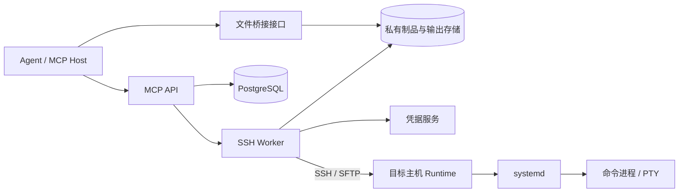
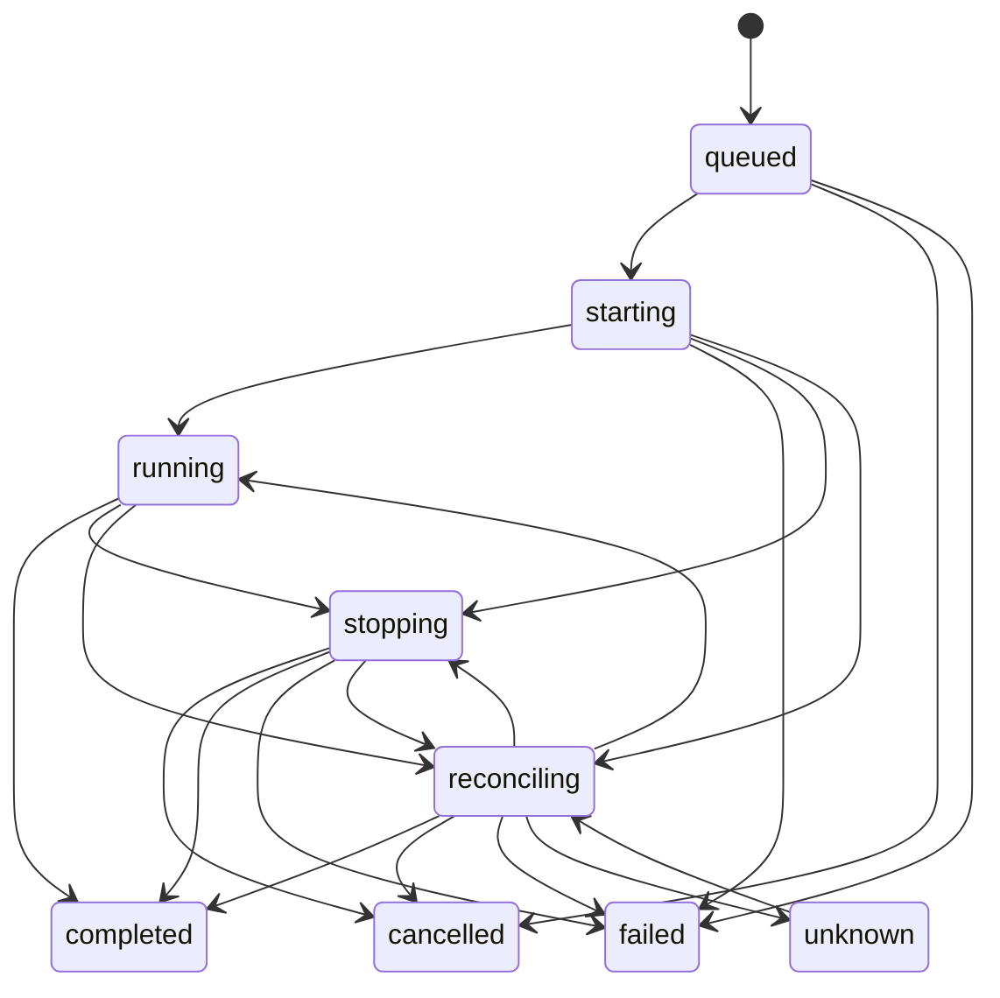

# 远程运维 MCP 实施方案 v1

本方案采用“Agent 负责运维决策，MCP 服务负责凭据调用、远程执行与事实回报”的分工。

本版范围为 Linux、OpenSSH/SFTP、systemd。登录采用 SSH 公钥认证，私钥由凭据服务保管。普通账号与 root 配置为独立访问身份。

文中的额度、期限和容量为 v1 设计值，由管理端配置。

## 1. 架构



| 组件 | 职责 |
|---|---|
| Agent | 诊断、编写命令、修改文件、选择部署方式、判断业务结果 |
| MCP API | 身份认证、权限检查、目标发现、会话管理、任务受理与查询 |
| SSH Worker | 建立连接、调用 Runtime、同步输出、核对远端状态 |
| 凭据服务 | 保管私钥，为受信任连接器提供 SSH 认证签名 |
| 远端 Runtime | 创建命令进程和 PTY、处理输入、记录输出与命令结果 |
| systemd | 托管 Runtime 及任务进程，执行运行期限和停止策略 |
| PostgreSQL | 保存授权、会话、任务、请求去重、Worker 租约和审计索引 |
| 私有存储 | 保存输出分段及传输制品 |
| 文件桥接接口 | 在 MCP Host 本地文件与服务端制品之间传输二进制内容 |

控制服务、Worker 和凭据服务部署在目标主机权限域之外。目标主机持有 SSH 公钥，禁止向目标转发认证 agent socket。

Runtime 安装目录由 root 管理。任务数据目录属于执行账号，权限为 `0700`，任务文件权限为 `0600`。

普通账号接入时配置 systemd user manager 与 linger；root 使用 system manager。

## 2. 核心对象与数据归属

| 对象 | 核心字段 | 权威来源 |
|---|---|---|
| Target | 主机别名、环境、连接地址、主机公钥、访问身份 | 管理端目标目录 |
| Profile | SSH 登录账号、凭据引用、权限说明、额度 | 管理端身份配置 |
| Grant | 主体、目标、身份、动作范围、有效期 | 授权存储 |
| Session | 授权主体、目标、身份、有效期、状态 | 控制服务 |
| Task | 操作参数、任务状态、停止意图、结果、输出索引 | 控制服务任务表 |
| RemoteTask | 命令结果、输入记录、输出分段、托管状态 | 远端 Runtime 与 systemd |
| Artifact | 内容长度、SHA-256、所属主体、保留期限 | 制品服务 |

远端执行事实经 Worker 写入任务表，MCP API 从任务表返回结果。禁止通过终端文本推断任务状态或解析业务结果字段。

## 3. 权限边界

### 3.1 授权主体

服务端从认证令牌取得：

```ts
type Principal = {
  principal_id: string;
  client_id: string;
  delegation_id: string;
};
```

Agent 请求参数禁止携带用于替代认证的用户身份字段。

`delegation_id` 由受信任认证端签发，用于区分同一用户授权的 Agent。多个 Agent 共用同一认证身份时，服务将其视为同一授权主体。

授权记录包含：

```ts
type Grant = {
  grant_id: string;
  principal: Principal;
  target_id: string;
  profile_id: string;
  actions: Array<
    "session:open" | "session:close" |
    "task:create" | "task:read" | "task:input" | "task:cancel" |
    "file:upload" | "file:download" |
    "artifact:read" | "artifact:write"
  >;
  expires_at: string;
  max_session_ttl_seconds: number;
  max_run_timeout_ms: number;
  max_concurrent_tasks: number;
};
```

每次工具调用检查当前授权与资源归属。持有 `session_id`、`task_id` 或 `artifact_id` 不构成授权。[MCP 状态句柄安全要求](https://modelcontextprotocol.io/docs/2026-07-28/tutorials/security/security_best_practices)

### 3.2 远端账号

- 命令执行、SFTP 和 Runtime 使用 Profile 指定的登录账号。
- root 使用独立 Profile，由授权记录控制访问。
- 本版提供固定登录身份，账号切换通过创建目标身份对应的会话完成。
- 账号拥有的 sudo 权限属于该身份的实际能力。Agent 使用 `sudo -n` 调用该能力，MCP 服务不注入 sudo 密码。
- shell 的文件和网络访问范围由操作系统、sudo 和网络策略决定。
- 文件接口中的路径规则约束文件接口，不能构成通用 shell 的路径隔离。

多个 Agent 使用同一远端账号时，主机上的账号可读数据属于共享权限域。API 资源隔离不等于操作系统数据隔离。

### 3.3 到期与撤销

会话到期、关闭或授权撤销后：

1. 拒绝新任务和终端输入。
2. 为关联活动任务持久记录停止意图。
3. 通知 Worker 执行停止。
4. 结果读取按当前 `task:read` 权限及资源归属判断。

目标不可达时，服务保留停止意图与未知状态。撤销应答表示控制侧授权失效，不能证明远端进程终止。

root 创建的账号、密钥、服务和部署结果属于持久变更。关闭会话或取消任务不承担撤销这些变更的职责。

## 4. MCP 接口契约

### 4.1 公共约定

- 时间采用 UTC RFC 3339。
- 时长字段使用名称注明的单位。
- ID 为不透明字符串。
- 产生状态变更的调用携带 `request_id`。
- 工具通过 `tools/call` 暴露，并提供 `inputSchema` 与 `outputSchema`。
- 业务结果从 `structuredContent` 读取。
- 本版使用业务任务 `task_id`，不启用 MCP Tasks 扩展。

MCP Tasks 扩展拥有协议层任务及协作式取消语义。本版业务任务负责远端执行生命周期，避免将协议完成当作进程停止。[MCP Tasks 扩展](https://tasks.extensions.modelcontextprotocol.io/specification/2026-07-28/tasks)

成功返回：

```ts
type Success<T> = {
  data: T;
  trace_id: string;
};
```

工具错误返回 `isError: true`，其 `structuredContent` 为：

```ts
type Failure = {
  error: {
    code: string;
    message: string;
    details: Record<string, unknown>;
  };
  trace_id: string;
};
```

错误码：

| 错误码 | 含义 |
|---|---|
| `INVALID_ARGUMENT` | 参数不符合接口契约 |
| `FORBIDDEN` | 授权范围不足 |
| `NOT_FOUND` | 资源不存在或对调用者不可见 |
| `SESSION_EXPIRED` | 会话到期 |
| `IDEMPOTENCY_CONFLICT` | 相同请求 ID 对应不同参数 |
| `REQUEST_EXPIRED` | 请求 ID 超过首次接收窗口，且无去重记录 |
| `QUOTA_EXCEEDED` | 并发、容量或期限超过授权额度 |
| `REMOTE_UNAVAILABLE` | 连接或前置检查失败 |
| `CAPABILITY_MISSING` | 目标缺少所需运行能力 |
| `ARTIFACT_NOT_READY` | 制品尚未完成内容校验 |
| `CURSOR_EXPIRED` | 游标对应的输出数据超过保留期限 |

任务受理后的执行异常通过任务结构表达。

### 4.2 目标与会话

```ts
type Target = {
  target_id: string;
  alias: string;
  environment: string;
  profiles: Array<{
    profile_id: string;
    login_user: string;
    privilege_description: string;
  }>;
};

type Session = {
  session_id: string;
  target_id: string;
  profile_id: string;
  login_user: string;
  state: "open" | "closed" | "expired" | "revoked";
  created_at: string;
  expires_at: string;
};
```

| 工具 | 参数 | `data` 返回结构 |
|---|---|---|
| `list_targets` | `{ environment?: string, cursor?: string, limit?: number }` | `{ items: Target[], next_cursor: string or null }` |
| `open_session` | `{ request_id, target_id, profile_id, ttl_seconds }` | `Session` |
| `close_session` | `{ request_id, session_id }` | `{ session: Session, stop_requested_task_ids: string[] }` |

`list_targets` 返回当前主体有权访问的目标和身份。

`open_session` 检查 SSH 主机公钥、登录身份和 Runtime 能力；连接检查完成后返回会话。会话属于服务端授权对象，其存活与 MCP HTTP 连接分离。

`close_session` 返回逻辑关闭结果，关联任务的停止结果通过任务接口查询。

### 4.3 命令与终端

```ts
type Terminal =
  | { kind: "pipe"; stdin: "open" | "closed" }
  | { kind: "pty"; rows: number; cols: number };

type ExecInput = {
  request_id: string;
  session_id: string;
  script: string;
  cwd: string;
  env: Record<string, string>;
  terminal: Terminal;
  run_timeout_ms: number;
};

type TaskHandle = {
  task_id: string;
};
```

| 工具 | 参数 | `data` 返回结构 |
|---|---|---|
| `exec` | `ExecInput` | `TaskHandle` |
| `write_stdin` | `StdinInput` | `InputReceipt` |
| `read_output` | `ReadOutputInput` | `OutputPage` |

执行规则：

- 每个 `exec` 创建一个任务。
- 命令解释器固定为 `/bin/bash --noprofile --norc`。
- `cwd` 为绝对路径，`env` 属于本任务。
- pipe 模式创建命令进程；PTY 模式创建终端 shell。
- 目录、环境变量和终端状态在任务之间隔离。
- 每个任务绑定一个输入主体。
- `run_timeout_ms` 超过授权额度或会话剩余期限时，返回参数错误。

输入结构：

```ts
type StdinInput = {
  request_id: string;
  task_id: string;
  input_seq: number;
  action:
    | { kind: "data"; data_base64: string }
    | { kind: "eof" }
    | { kind: "resize"; rows: number; cols: number };
};

type InputReceipt = {
  task_id: string;
  input_seq: number;
  status: "queued" | "dispatching" | "dispatched" | "input_unknown";
};
```

`input_seq` 从 1 递增。相同序号与相同内容返回原记录；相同序号携带不同内容时返回冲突。

Runtime 使用持久输入队列：

```text
queued → dispatching → dispatched
                 └→ input_unknown
```

`dispatching` 在写入进程前落盘。该阶段发生 Runtime 崩溃时，序号进入 `input_unknown`，禁止重发。该机制约束派发尝试次数，不能证明应用消费输入。

`eof` 用于 pipe stdin 半关闭。PTY 的 Ctrl-D 使用 `data` 发送，其行为取决于终端模式。`resize` 用于 PTY。

输出结构：

```ts
type ReadOutputInput = {
  task_id: string;
  cursor: string | null;
  max_bytes: number;
  wait_ms: number;
};

type OutputPage = {
  task_id: string;
  chunks: Array<{
    seq: number;
    stream: "stdout" | "stderr" | "pty";
    data_base64: string;
    captured_at: string;
  }>;
  gaps: Array<{
    from_seq: number;
    to_seq_exclusive: number | null;
    reason: "quota" | "retention" | "capture_lost";
  }>;
  next_cursor: string;
  eof: boolean;
};
```

`cursor: null` 表示从序号起点读取。游标属于读位置，读取不消耗其他读取者的进度。

pipe 模式区分 stdout、stderr；PTY 使用合并输出流。跨流序号表示 Runtime 的采集顺序。

`eof: true` 表示输出封闭，且游标到达持久输出末尾。本次无输出与输出结束属于不同结果。无法确定丢失尾部长度时，`to_seq_exclusive` 为 `null`。

### 4.4 文件传输

文件内容经制品服务传输。MCP 工具接收制品 ID，禁止将 Agent 本机路径解释为 MCP 服务端路径。

```ts
type Artifact = {
  artifact_id: string;
  name: string;
  size_bytes: number;
  sha256: string;
  created_at: string;
  expires_at: string;
};

type UploadInput = {
  request_id: string;
  session_id: string;
  artifact_id: string;
  remote_path: string;
  overwrite: "deny" | "replace";
  mode: "0600" | "0644" | "0750" | "0755";
  run_timeout_ms: number;
};

type DownloadInput = {
  request_id: string;
  session_id: string;
  remote_path: string;
  max_bytes: number;
  run_timeout_ms: number;
};
```

| 工具 | 参数 | `data` 返回结构 |
|---|---|---|
| `upload` | `UploadInput` | `TaskHandle` |
| `download` | `DownloadInput` | `TaskHandle` |
| `get_artifact` | `{ artifact_id }` | `Artifact` |

上传规则：

1. 制品通过长度和 SHA-256 校验后冻结内容。
2. SFTP 将内容传入执行账号的 staging 目录。
3. Runtime 在目标文件所在目录创建临时文件，复制、校验并设置 `mode`。
4. `deny` 使用原子“不覆盖”发布；目标存在时失败。
5. `replace` 使用同文件系统 rename 替换末级目录项，包括符号链接本身，禁止跟随末级链接写入其指向文件。
6. 发布结果写入远端任务记录，Worker 同步结果。

父目录遵循操作系统路径解析与权限规则。目标目录缺失、目标为目录、文件系统缺少所需原子操作时返回失败。

发布应答丢失且证据不足时，任务进入未知状态，禁止重放文件发布。

下载任务将捕获的字节形成制品，完成校验后返回 `artifact_id`。在线变化文件的业务一致性由 Agent 通过停写、导出或快照建立。

### 4.5 文件桥接 HTTP 接口

文件桥接由 MCP Host 的客户端组件调用，使用与 MCP 相同的认证体系。

| 接口 | 请求 | 返回 |
|---|---|---|
| `POST /artifact-uploads` | `{ name, size_bytes, sha256 }` | `{ upload_id, part_size_bytes, expires_at }` |
| `PUT /artifact-uploads/{id}/parts/{index}` | 二进制分块 | `{ index, size_bytes, sha256 }` |
| `GET /artifact-uploads/{id}` | 无请求体 | `{ uploaded_parts: number[], expires_at }` |
| `POST /artifact-uploads/{id}/complete` | 无请求体 | `Artifact` |
| `GET /artifacts/{id}/content` | 支持 HTTP Range | 二进制内容及长度、哈希响应头 |

分块序号从 0 开始。相同分块重复提交相同内容时返回原记录，内容变化时返回冲突。制品完成后禁止修改分块。

## 5. 任务返回结构

```ts
type TaskState =
  | "queued"
  | "starting"
  | "running"
  | "stopping"
  | "reconciling"
  | "unknown"
  | "completed"
  | "failed"
  | "cancelled";

type TaskResult =
  | {
      kind: "exec";
      termination:
        | { kind: "exit"; code: number }
        | { kind: "signal"; name: string };
      reason: "command_exit" | "cancel" | "deadline" | "session_closed";
    }
  | {
      kind: "upload";
      remote_path: string;
      size_bytes: number;
      sha256: string;
      mode: string;
      committed_at: string;
    }
  | {
      kind: "download";
      artifact: Artifact;
    };

type Task = {
  task_id: string;
  session_id: string;
  kind: "exec" | "upload" | "download";
  state: TaskState;
  created_at: string;
  started_at: string | null;
  finished_at: string | null;
  deadline_at: string;
  last_observed_at: string | null;
  control_available: boolean;
  stop_request: {
    reason: "cancel" | "deadline" | "session_closed" | "grant_revoked";
    requested_at: string;
  } | null;
  result: TaskResult | null;
  failure: {
    code: string;
    message: string;
  } | null;
  output_closed: boolean;
  last_input: InputReceipt | null;
};
```

| 工具 | 参数 | `data` 返回结构 |
|---|---|---|
| `get_task` | `{ task_id, wait_ms?: number }` | `Task` |
| `list_tasks` | `{ session_id?: string, state?: TaskState, cursor?: string, limit?: number }` | `{ items: Task[], next_cursor: string or null }` |
| `cancel_task` | `{ request_id, task_id }` | `{ task: Task, stop_intent_recorded: boolean }` |

`get_task.wait_ms` 为等待状态变化的时长，超过等待期限返回快照。它不改变任务运行期限。

`list_tasks` 返回当前主体有权读取的任务。

## 6. 任务生命周期



| 状态 | 含义 |
|---|---|
| `queued` | 请求和任务记录落盘，等待 Worker |
| `starting` | Worker 取得执行权，准备或核对远端任务 |
| `running` | 存在远端运行证据 |
| `stopping` | 停止意图落盘，处理远端停止 |
| `reconciling` | 连接或执行权变化，核对远端事实 |
| `unknown` | 证据不足，无法确认运行或停止状态 |
| `completed` | 操作具有确定结果；命令非零退出属于该状态 |
| `failed` | 存在确定的服务执行失败，且远端工作未启动或停止得到确认 |
| `cancelled` | 启动前取消，或停止得到确认且结束原因属于取消、会话关闭或授权撤销 |

`completed` 不代表服务健康；`failed` 不代表没有业务副作用。Agent 根据命令结果和业务检查判断运维目标。

超时后的进程结束通过 `result.reason = "deadline"` 表达。取消与正常完成竞争时，以远端事实决定终态；文件发布完成后的取消不回滚文件。

### 6.1 请求去重

`request_id` 使用 UUIDv7：

- 去重键为“授权主体、工具名、request_id”。
- 保存规范化参数哈希与原结果引用。
- 相同 ID 和参数返回原资源；参数变化返回冲突。
- 新请求的 UUID 时间处于服务端 24 小时接收窗口内。
- 去重记录保留 30 天，活动任务记录覆盖其活动期限。
- 记录缺失且请求超过接收窗口时返回 `REQUEST_EXPIRED`。

去重用于防止请求重放引发重复提交，不能使任意 shell 命令获得业务幂等性。

### 6.2 Worker 接管

Worker 使用租约和单调递增的 `epoch`：

1. PostgreSQL 分配任务执行权与 epoch。
2. Runtime 持久保存任务身份、参数哈希与当前 epoch。
3. 接管 Worker 查询、附着原远端任务。
4. Runtime 拒绝旧 epoch 的输入及控制请求。

远端任务身份由 `task_id + nonce` 确定。发现同名任务时核对原记录，禁止删除后重建。

API 重启不改变活动任务状态。Worker 租约失效后触发对账。`queued` 任务启动前重查授权、会话、期限和停止意图。

### 6.3 远端进程托管

每个任务由一个 transient service 托管 Runtime：

```text
Type=exec
Restart=no
RemainAfterExit=no
KillMode=control-group
RuntimeMaxSec=<提交时剩余运行时长>
TimeoutStopSec=10s
SendSIGKILL=yes
```

PTY 由 Runtime 创建。Runtime 保存命令退出结果；固定 `ExecStopPost` finalizer 保存托管结束信息及输出封闭记录。

命令退出结果与 Runtime 退出结果属于两类证据。禁止用 Runtime 的退出码替代 Agent 命令退出码。

systemd 支持 transient service 和控制组停止策略；期限触发停止，停止宽限期结束触发 KILL。[systemd-run](https://www.freedesktop.org/software/systemd/man/latest/systemd-run.html)、[systemd.kill](https://www.freedesktop.org/software/systemd/man/latest/systemd.kill.html)

主机崩溃、Runtime 或 finalizer 故障造成证据缺失时，任务进入对账或未知状态。unit 消失、期限经过和 KILL 请求发出不能替代停止证据。

### 6.4 恢复承诺

| 事件 | 系统行为 |
|---|---|
| Agent 或 MCP HTTP 断线 | 会话和远端任务按期限存活，重连后查询和续读 |
| MCP API 重启 | 从持久存储恢复会话与任务查询 |
| SSH 断线、Worker 失效 | 远端托管继续，接管 Worker 核对状态并续读 |
| 目标重启 | 禁止重放任务，核对 boot ID 与持久记录 |
| 远端记录损坏或超过保留期 | 返回输出缺口或未知状态 |

回收保证覆盖受管 cgroup 内的进程。root 或具备提权能力的命令可以创建其他服务、改变托管机制或重启主机，这些行为超出进程回收保证。

## 7. 设计额度与审计

| 项目 | v1 设计值 |
|---|---:|
| 会话期限 | 2 小时，上限 8 小时 |
| 单任务运行时长 | 15 分钟，上限受会话剩余期限约束 |
| 停止宽限期 | 10 秒 |
| 单次查询等待 | 上限 20 秒 |
| 单次输入内容 | 上限 64 KiB |
| 单次输出读取 | 256 KiB，上限 1 MiB |
| 单任务输出容量 | 64 MiB |
| 单主体、目标、身份的活动任务数 | 4 |
| 文件桥接分块 | 8 MiB |
| 单制品容量 | 1 GiB |
| 输出与制品保留期 | 任务终态后 7 天 |
| 终态任务元数据与请求去重 | 30 天 |

输出超过额度时记录缺口并持续排空进程输出，防止输出阻塞命令。未知状态的任务保留元数据，禁止按超时推断终态。

审计记录包含主体、目标、身份、会话、任务、操作类型、参数哈希、授权决定和状态变化。命令、输入、输出与制品作为受控任务数据保存；常规日志记录引用与摘要。私钥、认证令牌和签名能力引用禁止进入 Agent 上下文及日志。

## 8. 实施事项清单

- 建立目标、身份与授权目录。
- 实现凭据签名和 SSH 连接器。
- 实现远端 Runtime 与 systemd 托管。
- 实现任务状态、去重与接管。
- 实现终端输入和输出续读。
- 实现制品桥接与文件发布。
- 接入权限撤销、额度和审计。

本版为实施方案，尚未实施。
