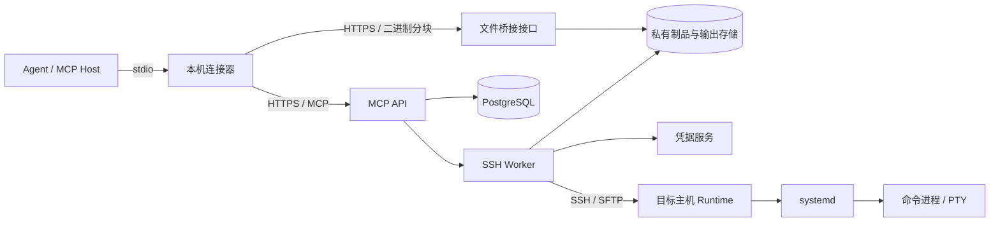
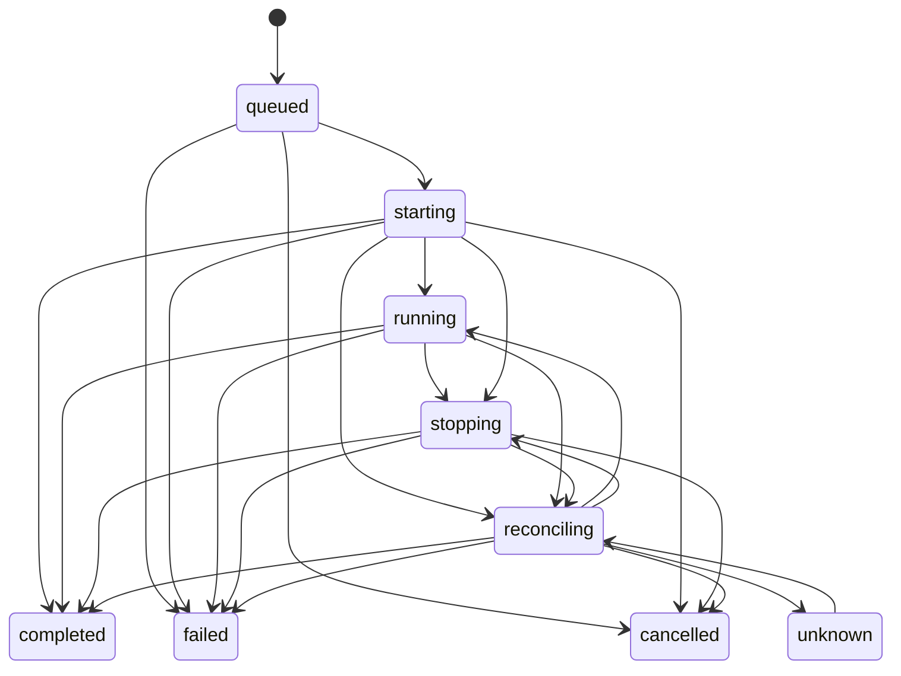

# 远程运维 MCP 实施方案 V2

版本：V2。前版：[远程运维 MCP 实施方案 V1](远程运维MCP实施方案V1.md)。

本方案采用“Agent 负责运维决策，MCP 服务负责凭据调用、远程执行与事实回报”的分工。

本版范围为 Linux、OpenSSH/SFTP、systemd。登录采用 SSH 公钥认证，私钥由凭据服务保管。普通账号与 root 配置为独立访问身份。

文中的额度、期限和容量为 V2 设计值，由管理端配置。本版交付本机 stdio 连接器、远端 MCP 服务和目标主机 Runtime。

## 1. 架构



| 组件 | 职责 |
|---|---|
| Agent | 诊断、编写命令、修改文件、选择部署方式、判断业务结果 |
| 本机连接器 | 暴露 stdio MCP 工具、管理服务登录、转发远端工具、搬运本地文件与制品 |
| MCP API | 身份认证、权限检查、目标发现、会话管理、任务受理与查询 |
| SSH Worker | 建立连接、调用 Runtime、同步输出、核对远端状态 |
| 凭据服务 | 保管私钥，为控制域内 SSH Worker 提供认证签名；本机连接器无签名访问权 |
| 远端 Runtime | 创建命令进程和 PTY、处理输入、记录输出与命令结果 |
| systemd | 托管 Runtime 及任务进程，执行运行期限和停止策略 |
| PostgreSQL | 保存授权、会话、任务、请求去重、Worker 租约和审计索引 |
| 私有存储 | 保存输出分段及传输制品 |
| 文件桥接接口 | 接收本机连接器的二进制请求，执行制品来源授权与内容校验 |

控制服务、Worker 和凭据服务部署在目标主机权限域之外。目标主机持有 SSH 公钥，禁止向目标转发认证 agent socket。

Runtime 安装目录由 root 管理。任务数据目录属于执行账号，权限为 `0700`，任务文件权限为 `0600`。

普通账号接入时配置 systemd user manager 与 linger；root 使用 system manager。

## 2. 核心对象与数据归属

| 对象 | 核心字段 | 权威来源 |
|---|---|---|
| Target | 主机别名、环境、连接地址、主机公钥、访问身份 | 管理端目标目录 |
| Profile | SSH 登录账号、凭据引用、权限说明、额度 | 管理端身份配置 |
| Grant | 主体、目标、身份、动作范围、有效期 | 授权存储 |
| Session | 授权主体、目标、身份、有效期、状态；主体、目标、身份创建后固定 | 控制服务 |
| Task | 来源会话、操作参数、状态版本、结束信息、结果、输出索引 | 控制服务任务表 |
| TaskExecution | Worker、epoch、租约、远端 nonce | 控制服务执行权记录 |
| TaskStopRequest | 任务、停止请求 ID、原因、接收时间 | 控制服务停止意图记录 |
| RemoteTask | 命令结果、输入记录、输出分段、托管状态 | 远端 Runtime 与 systemd |
| Artifact | 内容长度、SHA-256、来源引用、保留期限；授权主体与范围从来源推导 | 制品服务 |

远端执行事实经 Worker 写入任务表，MCP API 从任务表返回结果。禁止通过终端文本推断任务状态或解析业务结果字段。

## 3. 权限边界

### 3.1 授权主体

服务端从认证令牌取得：

```ts
type Principal = {
  principal_id: string;
  client_id: string;
  delegation_id: string;
};
```

Agent 请求参数禁止携带用于替代认证的用户身份字段。

`delegation_id` 由受信任认证端签发，用于区分同一用户授权的 Agent。多个 Agent 共用同一认证身份时，服务将其视为同一授权主体。

授权记录包含：

```ts
type Grant = {
  grant_id: string;
  principal: Principal;
  target_id: string;
  profile_id: string;
  actions: Array<
    "session:open" | "session:close" |
    "task:create" | "task:read" | "task:input" | "task:cancel" |
    "file:upload" | "file:download" |
    "artifact:read" | "artifact:write"
  >;
  expires_at: string;
  max_session_ttl_seconds: number;
  max_run_timeout_ms: number;
  max_concurrent_tasks: number;
};
```

每次工具调用检查当前授权与资源归属。持有 `session_id`、`task_id` 或 `artifact_id` 不构成授权。[MCP 状态句柄安全要求](https://modelcontextprotocol.io/docs/2026-07-28/tutorials/security/security_best_practices)

### 3.2 远端账号

- 命令执行、SFTP 和 Runtime 使用 Profile 指定的登录账号。
- root 使用独立 Profile，由授权记录控制访问。
- 本版提供固定登录身份，账号切换通过创建目标身份对应的会话完成。
- 账号拥有的 sudo 权限属于该身份的实际能力。Agent 使用 `sudo -n` 调用该能力，MCP 服务不注入 sudo 密码。
- shell 的文件和网络访问范围由操作系统、sudo 和网络策略决定。
- 文件接口中的路径规则约束文件接口，不能构成通用 shell 的路径隔离。

多个 Agent 使用同一远端账号时，主机上的账号可读数据属于共享权限域。API 资源隔离不等于操作系统数据隔离。

### 3.3 到期与撤销

会话到期、关闭或授权撤销后：

1. 拒绝新任务和终端输入。
2. 为关联活动任务持久记录停止意图。
3. 通知 Worker 执行停止。
4. 任务结果与输出读取按来源会话的主体、目标和身份检查当前 `task:read` 权限。
5. 制品读取与使用执行第 3.4 节的来源授权规则；停止依赖被撤销权限的活动传输。

目标不可达时，服务保留停止意图与未知状态。撤销应答表示控制侧授权失效，不能证明远端进程终止。

root 创建的账号、密钥、服务和部署结果属于持久变更。关闭会话或取消任务不承担撤销这些变更的职责。

### 3.4 制品来源与授权

制品保存一个带类型的来源引用：

```ts
type ArtifactSource =
  | { kind: "client_upload"; session_id: string }
  | { kind: "task_download"; task_id: string };
```

授权范围沿以下路径取得：

| 来源 | 授权主体、目标、身份的来源路径 |
|---|---|
| 本地上传 | Artifact.source.session_id → Session → Principal、Target、Profile |
| 任务下载 | Artifact.source.task_id → Task.session_id → Session → Principal、Target、Profile |

来源由服务端生成并在创建后固定。禁止接受调用者传入的主体、目标或身份作为来源替代值；制品不维护第二套可变授权范围。来源会话与任务的关联记录保留至引用制品清理完成。

每次访问要求调用者 Principal 与来源主体一致，且存在匹配来源 target_id、profile_id 的当前有效 Grant。其他目标或身份的同名 action 不构成授权。历史 Grant 记录用于审计，权限判断使用当前有效授权。

| 操作 | 权限与状态条件 |
|---|---|
| 创建桥接上传、写分块、首次完成上传 | 来源会话 open；来源范围具有 artifact:write |
| 查询上传管理记录、重取完成回执 | 来源范围具有 artifact:write；返回进度和制品 ID，禁止返回制品正文 |
| get_artifact、读取制品内容 | 来源范围具有 artifact:read；task_download 来源还要求 task:read |
| upload 将制品写入远端 | 满足来源制品读取条件；目标会话 open；目标范围具有 task:create、file:upload |
| download 创建制品 | 来源会话 open；来源范围具有 task:create、file:download、artifact:write |

跨目标传输要求来源读取权限与目标写入权限同时成立。禁止通过改换目标会话、修改制品来源或创建另一身份的 Grant 绕过来源范围检查。

完成的制品可在来源会话关闭后读取，条件是当前来源范围权限有效且制品在保留期内。未完成桥接上传在来源会话关闭、到期或授权撤销后停止接收分块，进入清理队列。

上传任务登记来源制品引用及目标会话引用，权限依赖从这些引用推导。权限检查覆盖受理、启动、来源内容读取和远端发布；任一依赖范围撤权时写入停止意图。HTTP 内容响应在建立响应前和分块续传时鉴权，长响应在发送分块边界检查撤权状态；撤权事件关闭匹配的活动响应。传输到客户端或目标 staging 的字节不具备远程收回承诺。

后台停止、对账和临时文件清理使用服务内部维护权限，绑定原任务范围；维护权限禁止创建 Agent 命令或向撤权主体返回内容。

## 4. MCP 接口契约

### 4.1 公共约定

- 时间采用 UTC RFC 3339。
- 时长字段使用名称注明的单位。
- ID 为不透明字符串。
- 产生状态变更的 MCP 调用及 HTTP 上传创建携带 `request_id`；分块和上传完成使用第 4.5 节的资源去重键。
- 工具通过 `tools/call` 暴露，并提供 `inputSchema` 与 `outputSchema`。
- 业务结果从 `structuredContent` 读取。
- 本版使用业务任务 `task_id`，不启用 MCP Tasks 扩展。

MCP Tasks 扩展拥有协议层任务及协作式取消语义。本版业务任务负责远端执行生命周期，避免将协议完成当作进程停止。[MCP Tasks 扩展](https://tasks.extensions.modelcontextprotocol.io/specification/2026-07-28/tasks)

成功返回：

```ts
type Success<T> = {
  data: T;
  trace_id: string;
};
```

工具错误返回 `isError: true`，其 `structuredContent` 为：

```ts
type Failure = {
  error: {
    code: string;
    message: string;
    details: Record<string, unknown>;
  };
  trace_id: string;
};
```

错误码：

| 错误码 | 含义 |
|---|---|
| `INVALID_ARGUMENT` | 参数不符合接口契约 |
| `FORBIDDEN` | 授权范围不足 |
| `NOT_FOUND` | 资源不存在或对调用者不可见 |
| `SESSION_EXPIRED` | 会话到期 |
| `IDEMPOTENCY_CONFLICT` | 相同请求 ID 对应不同参数 |
| `REQUEST_EXPIRED` | 请求 ID 超过首次接收窗口，且无去重记录 |
| `QUOTA_EXCEEDED` | 并发、容量或期限超过授权额度 |
| `REMOTE_UNAVAILABLE` | 连接或前置检查失败 |
| `CAPABILITY_MISSING` | 目标缺少所需运行能力 |
| `ARTIFACT_NOT_READY` | 制品尚未完成内容校验 |
| `CURSOR_EXPIRED` | 游标对应的输出数据超过保留期限 |

任务受理后的执行异常通过任务结构表达。

### 4.2 目标与会话

```ts
type Target = {
  target_id: string;
  alias: string;
  environment: string;
  profiles: Array<{
    profile_id: string;
    login_user: string;
    privilege_description: string;
  }>;
};

type Session = {
  session_id: string;
  target_id: string;
  profile_id: string;
  login_user: string;
  state: "open" | "closed" | "expired" | "revoked";
  created_at: string;
  expires_at: string;
};
```

| 工具 | 参数 | `data` 返回结构 |
|---|---|---|
| `list_targets` | `{ environment?: string, cursor?: string, limit?: number }` | `{ items: Target[], next_cursor: string or null }` |
| `open_session` | `{ request_id, target_id, profile_id, ttl_seconds }` | `Session` |
| `close_session` | `{ request_id, session_id }` | `{ session: Session, stop_requested_task_ids: string[] }` |

`list_targets` 返回当前主体有权访问的目标和身份。

`open_session` 检查 SSH 主机公钥、登录身份和 Runtime 能力；连接检查完成后返回会话。会话属于服务端授权对象，其存活与 MCP HTTP 连接分离。

`close_session` 返回逻辑关闭结果，关联任务的停止结果通过任务接口查询。

### 4.3 命令与终端

```ts
type Terminal =
  | { kind: "pipe"; stdin: "open" | "closed" }
  | { kind: "pty"; rows: number; cols: number };

type ExecInput = {
  request_id: string;
  session_id: string;
  script: string;
  cwd: string;
  env: Record<string, string>;
  terminal: Terminal;
  run_timeout_ms: number;
};

type TaskHandle = {
  task_id: string;
};
```

| 工具 | 参数 | `data` 返回结构 |
|---|---|---|
| `exec` | `ExecInput` | `TaskHandle` |
| `write_stdin` | `StdinInput` | `InputReceipt` |
| `read_output` | `ReadOutputInput` | `OutputPage` |

执行规则：

- 每个 `exec` 创建一个任务。
- 命令解释器固定为 `/bin/bash --noprofile --norc`。
- `cwd` 为绝对路径，`env` 属于本任务。
- pipe 模式创建命令进程；PTY 模式创建终端 shell。
- 目录、环境变量和终端状态在任务之间隔离。
- 每个任务绑定一个输入主体。
- `run_timeout_ms` 超过授权额度或会话剩余期限时，返回参数错误。

输入结构：

```ts
type StdinInput = {
  request_id: string;
  task_id: string;
  input_seq: number;
  action:
    | { kind: "data"; data_base64: string }
    | { kind: "eof" }
    | { kind: "resize"; rows: number; cols: number };
};

type InputReceipt = {
  task_id: string;
  input_seq: number;
  status: "queued" | "dispatching" | "dispatched" | "input_unknown";
};
```

`input_seq` 从 1 递增。相同序号与相同内容返回原记录；相同序号携带不同内容时返回冲突。

Runtime 使用持久输入队列：

```text
queued → dispatching → dispatched
                 └→ input_unknown
```

`dispatching` 在写入进程前落盘。该阶段发生 Runtime 崩溃时，序号进入 `input_unknown`，禁止重发。该机制约束派发尝试次数，不能证明应用消费输入。

`eof` 用于 pipe stdin 半关闭。PTY 的 Ctrl-D 使用 `data` 发送，其行为取决于终端模式。`resize` 用于 PTY。

输出结构：

```ts
type ReadOutputInput = {
  task_id: string;
  cursor: string | null;
  max_bytes: number;
  wait_ms: number;
};

type OutputPage = {
  task_id: string;
  chunks: Array<{
    seq: number;
    stream: "stdout" | "stderr" | "pty";
    data_base64: string;
    captured_at: string;
  }>;
  gaps: Array<{
    from_seq: number;
    to_seq_exclusive: number | null;
    reason: "quota" | "retention" | "capture_lost";
  }>;
  next_cursor: string;
  eof: boolean;
};
```

`cursor: null` 表示从序号起点读取。游标属于读位置，读取不消耗其他读取者的进度。

pipe 模式区分 stdout、stderr；PTY 使用合并输出流。跨流序号表示 Runtime 的采集顺序。

`eof: true` 表示输出封闭，且游标到达持久输出末尾。本次无输出与输出结束属于不同结果。无法确定丢失尾部长度时，`to_seq_exclusive` 为 `null`。

### 4.4 文件传输

文件内容经制品服务传输。MCP 工具接收制品 ID，禁止将 Agent 本机路径解释为 MCP 服务端路径。

```ts
type Artifact = {
  artifact_id: string;
  source: ArtifactSource;
  name: string;
  size_bytes: number;
  sha256: string;
  created_at: string;
  expires_at: string;
};

type UploadInput = {
  request_id: string;
  session_id: string;
  artifact_id: string;
  remote_path: string;
  overwrite: "deny" | "replace";
  mode: "0600" | "0644" | "0750" | "0755";
  run_timeout_ms: number;
};

type DownloadInput = {
  request_id: string;
  session_id: string;
  remote_path: string;
  max_bytes: number;
  run_timeout_ms: number;
};
```

| 工具 | 参数 | `data` 返回结构 |
|---|---|---|
| `upload` | `UploadInput` | `TaskHandle` |
| `download` | `DownloadInput` | `TaskHandle` |
| `get_artifact` | `{ artifact_id }` | `Artifact` |

上传规则：

1. 制品通过长度和 SHA-256 校验后冻结内容。
2. SFTP 将内容传入执行账号的 staging 目录。
3. Runtime 在目标文件所在目录创建临时文件，复制、校验并设置 `mode`。
4. `deny` 使用原子“不覆盖”发布；目标存在时失败。
5. `replace` 使用同文件系统 rename 替换末级目录项，包括符号链接本身，禁止跟随末级链接写入其指向文件。
6. 发布结果写入远端任务记录，Worker 同步结果。

父目录遵循操作系统路径解析与权限规则。目标目录缺失、目标为目录、文件系统缺少所需原子操作时返回失败。

发布应答丢失时进入对账。无法确认执行停止时进入 unknown；停止得到确认但发布结果无法恢复时，按第 5.1 节形成终态，result_availability 为 lost。结束原因采用经证据确认的停止原因或服务故障，缺少这些原因证据时使用 result_lost。两种情况均禁止重放文件发布，禁止推断目标文件没有发生变化。

下载任务将捕获的字节形成制品，完成校验后返回 `artifact_id`。在线变化文件的业务一致性由 Agent 通过停写、导出或快照建立。

### 4.5 文件桥接 HTTP 接口

文件桥接由第 4.6 节的本机连接器调用。MCP endpoint 与制品 endpoint 属于同一个受保护服务资源，检查令牌的 issuer、audience、有效期与授权范围；令牌在 HTTPS Authorization 头中传递。

| 接口 | 请求 | 返回 |
|---|---|---|
| `POST /artifact-uploads` | `{ request_id, session_id, name, size_bytes, sha256 }` | `{ upload_id, part_size_bytes, expires_at }` |
| `PUT /artifact-uploads/{id}/parts/{index}` | 二进制分块 | `{ index, size_bytes, sha256 }` |
| `GET /artifact-uploads/{id}` | 无请求体 | `{ state, uploaded_parts: number[], artifact_id: string or null, expires_at }` |
| `POST /artifact-uploads/{id}/complete` | 无请求体 | `{ artifact_id: string }` |
| `GET /artifacts/{id}/content` | 支持 HTTP Range | 二进制内容及长度、哈希响应头 |

创建上传时，服务端从 session_id 生成 client_upload 来源，禁止客户端替换来源。上传记录 state 为 open、completed、expired 或 cancelled。上传管理记录的查询按来源主体及范围的当前 artifact:write 检查，禁止读取其他主体记录。首次完成要求来源会话有效；completed 状态重取原回执不要求会话 open，不恢复会话或写权限。元数据和内容读取经 get_artifact 与内容接口，执行 artifact:read 检查。

分块序号从 0 开始。分块去重键为 upload_id 与 index；相同内容返回原记录，内容变化时返回冲突。完成操作以 upload_id 去重，校验长度与 SHA-256 后冻结内容，并将上传记录与制品关联写入同一事务。完成应答丢失时，连接器查询原上传记录或重取完成回执，获得原 artifact_id；禁止创建替代制品来掩盖未知结果。制品完成后禁止修改分块。

### 4.6 本机文件桥接交付

交付一个名为 remote-ops-connector 的本机 stdio MCP 可执行程序，提供 macOS、Windows、Linux 安装包。MCP Host 通过配置该程序接入；Host 需要支持启动 stdio MCP 服务。连接器作为客户端组件承载文件桥接，服务端 HTTP 接口不依赖 Host 添加专用文件 API。

连接器配置包含服务地址、受信任认证服务信息和允许访问的本地根目录。首次使用执行浏览器授权码与 PKCE 登录，认证端签发 client_id、delegation_id 对应的授权上下文。MCP 请求和文件请求使用同一上下文。访问令牌与刷新令牌存入系统凭据库；凭据库缺失或锁定时返回连接错误。stdout 承载 MCP 消息，诊断输出进入 stderr。

连接器聚合远端工具与以下本地工具。远端工具的业务参数、request_id、返回结构和错误语义沿原契约转发；保留本地工具名，发现名称冲突时拒绝启动。

```ts
type LocalTransferHandle = { local_transfer_id: string };

type LocalTransfer = {
  local_transfer_id: string;
  state: "queued" | "running" | "completed" | "failed" | "cancelled" | "unknown";
  result:
    | { kind: "stage"; artifact_id: string }
    | { kind: "fetch"; local_path: string; size_bytes: number; sha256: string }
    | null;
  failure: { code: string; message: string } | null;
};
```

| 本地工具 | 参数 | data 返回结构 |
|---|---|---|
| stage_local_file | `{ request_id, session_id, local_path }` | LocalTransferHandle |
| fetch_artifact | `{ request_id, artifact_id, local_path, overwrite: "deny" or "replace" }` | LocalTransferHandle |
| get_local_transfer | `{ local_transfer_id }` | LocalTransfer |
| cancel_local_transfer | `{ request_id, local_transfer_id }` | LocalTransfer |

本地路径参数由连接器消费，禁止转发到远端工具或制品 API；制品 name 使用文件名。路径解析与打开操作限制在配置的本地根目录内，处理父目录、符号链接和路径替换竞争，禁止越出根目录。连接器的凭据与内部状态目录不属于可传输根目录。

本地到远端的路径为：stage_local_file 生成受控临时快照并计算哈希 → 创建上传记录与传输分块 → 返回 artifact_id → Agent 调用远端 upload。远端到本地的路径为：download 返回 artifact_id → fetch_artifact 调用 get_artifact 取得元数据并发起受鉴权的 HTTP Range 读取 → 校验哈希 → 在目标目录以临时文件完成发布。deny 的本地发布要求目标不存在，replace 替换末级目录项；缺少所需原子操作时返回能力错误。

本地传输与远端任务使用独立 ID。连接器将本地操作、request_id、授权上下文引用、upload_id、分块进度和结果保存在私有 SQLite 日志，文件权限限制为当前用户。创建类请求按授权上下文、工具名、request_id 去重；查询、取消与续传要求日志绑定上下文与连接器当前上下文匹配。状态查询不推进操作。

连接器重启时，使用原上传记录或原制品恢复分块读取；禁止重放远端 upload、download 或 exec。落盘发布与本地记录之间存在不确定性时标记 unknown，保留原 ID 供核对。cancel_local_transfer 停止本地网络和文件操作，丢弃未发布临时文件；发布完成时返回 completed，停止应答不撤销文件。取消本地传输不等于取消远端任务，远端取消使用 cancel_task。

连接器的令牌和 SSH 登录私钥不进入模型上下文。本地传输日志不保存令牌；失败返回结构保留操作 ID，避免让 Agent 以新请求掩盖未知状态。

## 5. 任务返回结构

```ts
type StopReason =
  | "cancel"
  | "deadline"
  | "session_closed"
  | "session_expired"
  | "grant_revoked";

type TaskEnd = {
  reason: "operation_finished" | StopReason | "service_failure" | "result_lost";
  execution: "not_started" | "stopped";
  result_availability: "available" | "not_produced" | "lost";
};

type TaskState =
  | "queued"
  | "starting"
  | "running"
  | "stopping"
  | "reconciling"
  | "unknown"
  | "completed"
  | "failed"
  | "cancelled";

type TaskResult =
  | {
      kind: "exec";
      termination:
        | { kind: "exit"; code: number }
        | { kind: "signal"; name: string };
    }
  | {
      kind: "upload";
      remote_path: string;
      size_bytes: number;
      sha256: string;
      mode: string;
      committed_at: string;
    }
  | {
      kind: "download";
      artifact_id: string;
    };

type Task = {
  task_id: string;
  session_id: string;
  kind: "exec" | "upload" | "download";
  state: TaskState;
  created_at: string;
  started_at: string | null;
  finished_at: string | null;
  deadline_at: string;
  last_observed_at: string | null;
  control_available: boolean;
  stop_request: {
    stop_id: string;
    reason: StopReason;
    requested_at: string;
  } | null;
  end: TaskEnd | null;
  result: TaskResult | null;
  failure: {
    code: string;
    message: string;
  } | null;
  output_closed: boolean;
  last_input: InputReceipt | null;
};
```

| 工具 | 参数 | `data` 返回结构 |
|---|---|---|
| `get_task` | `{ task_id, wait_ms?: number }` | `Task` |
| `list_tasks` | `{ session_id?: string, state?: TaskState, cursor?: string, limit?: number }` | `{ items: Task[], next_cursor: string or null }` |
| `cancel_task` | `{ request_id, task_id }` | `{ task: Task, stop_intent_recorded: boolean }` |

`get_task.wait_ms` 为等待状态变化的时长，超过等待期限返回快照。它不改变任务运行期限。

`list_tasks` 返回当前主体有权读取的任务。

### 5.1 终态字段约束

三类任务的结束原因从 Task.end.reason 读取。TaskResult 保存操作事实，禁止在结果分支增加第二条结束原因路径。stop_request 表示控制意图，end 表示经证据确认的结束事实。

| state | end.reason | result 与 failure |
|---|---|---|
| queued、starting、running、stopping、reconciling、unknown | end 为 null | result、failure、finished_at 为 null；stop_request 可存在 |
| completed | operation_finished | result 非 null，kind 与任务匹配；failure 为 null |
| cancelled | cancel、session_closed、session_expired、grant_revoked | stop_request 非 null；result 按可用性赋值；failure 为 null |
| failed | deadline、service_failure、result_lost | failure 非 null；result 按可用性赋值 |

终态要求 finished_at 非 null，end.execution 为 not_started 或 stopped，且控制侧持有对应证据。终态发布前，将可取得的输出分段、缺口和封闭标记同步到控制侧，output_closed 为 true。执行状态或终止证据不足时保持 reconciling 或 unknown。

result_availability 的约束如下：

- available：result 非 null，并且来自对应操作的持久结果。
- not_produced：result 为 null，存在未启动或未产生操作结果的证据；例如排队阶段取消、上传发布前停止。
- lost：result 为 null，执行停止得到确认，但命令退出结果或文件发布结果缺失。禁止推断执行成功、退出码为零或文件没有变化。

completed 要求 result_availability 为 available。命令非零退出属于 completed，其业务含义由 Agent 判断。上传的成功结果要求远端发布记录；下载的成功结果要求制品冻结记录。

cancelled 的结束原因与生效的 stop_id 对应。排队取消通过关闭启动入口证明 not_started；运行取消通过 Runtime 或 systemd 的托管停止证据证明 stopped。停止得到确认但命令退出结果丢失时，可返回 cancelled、result 为 null、result_availability 为 lost；这不构成回滚或无副作用证明。

deadline 适用于三类任务，映射 failed，failure.code 为 TASK_DEADLINE。正常操作完成记录与停止请求竞争时，按持久的操作完成、停止生效或文件发布事件判定；正常完成或发布事件早于停止生效时返回 completed，保留停止意图供审计。停止生效引起的命令退出按对应停止原因结束，存在退出码不构成正常完成证明。禁止根据取消请求的存在改变正常完成结果。

停止得到确认而操作结果无法恢复，且没有确定的停止原因或服务故障时，映射 failed，end.reason 为 result_lost，failure.code 为 RESULT_LOST。文件发布结果缺失使用相同规则，禁止重放。若操作结果存在但结束原因缺乏证据，映射 failed、service_failure，failure.code 为 END_CAUSE_UNAVAILABLE。存在确定的服务执行故障时，end.reason 为 service_failure，failure.code 说明故障。

运行后停止证据绑定 task_id、远端 nonce、boot_id 与 unit invocation ID。Runtime 的退出状态不替代 Agent 命令 termination。unit 消失、SSH 中断或期限经过不构成停止证据。

## 6. 任务生命周期



| 状态 | 含义 |
|---|---|
| `queued` | 请求和任务记录落盘，等待 Worker |
| `starting` | Worker 取得执行权，准备或核对远端任务 |
| `running` | 存在远端运行证据 |
| `stopping` | 停止意图落盘，处理远端停止 |
| `reconciling` | 连接或执行权变化，核对远端事实 |
| `unknown` | 证据不足，执行状态或托管停止事实待核对 |
| `completed` | 操作具有确定结果；命令非零退出属于该状态 |
| `failed` | 截止期限、服务故障或结果丢失，且远端工作未启动或停止得到确认 |
| `cancelled` | 启动前取消，或停止得到确认且结束原因属于取消、会话关闭、会话到期或授权撤销 |

`completed` 不代表服务健康；`failed` 不代表没有业务副作用。Agent 根据命令结果和业务检查判断运维目标。

超时结束通过 Task.end.reason = deadline 表达，按第 5.1 节填充终态字段。文件发布完成后的取消不回滚文件。completed、failed、cancelled 为终态，禁止后续观察覆盖其状态、结束原因或结果。

### 6.1 请求去重

`request_id` 使用 UUIDv7：

- 去重键为“授权主体、工具名、request_id”。
- 保存规范化参数哈希与原结果引用。
- 相同 ID 和参数返回原资源；参数变化返回冲突。
- 新请求的 UUID 时间处于服务端 24 小时接收窗口内。
- 去重记录保留 30 天，活动任务记录覆盖其活动期限。
- 记录缺失且请求超过接收窗口时返回 `REQUEST_EXPIRED`。

去重用于防止请求重放引发重复提交，不能使任意 shell 命令获得业务幂等性。

### 6.2 Worker 接管

执行权记录保存 task_id、owner_worker_id、epoch、lease_expires_at、remote_nonce。Task 保存 version 与 last_remote_revision。epoch 和 version 使用数据库整数，在外部接口出现时使用十进制字符串。

#### 6.2.1 执行权与远端控制

1. PostgreSQL 在事务中锁定执行权记录，为首次领取或失效接管分配新 epoch。续租条件包含当前 Worker、epoch 和有效租约；租约失效后走接管流程。
2. 新 Worker 携带 task_id、remote_nonce、参数哈希与 epoch 调用 Runtime 附着接口。Runtime 在任务锁内持久保存新 epoch，返回原任务及当前 revision。
3. 附着应答完成后，新 Worker 执行输入和停止请求。Runtime 在同一任务锁内检查 epoch 与操作序号；新 epoch 生效后拒绝旧 epoch 请求。
4. Worker 在租约失效或续租失败后停止发起控制及写回。接管前的远端调用结果通过对账处理，禁止重发命令弥补应答丢失。

remote_nonce 在任务创建事务中生成并固定。远端以 task_id 与 nonce 建立原子创建记录；启动记录、参数哈希与命名 unit 对应。Runtime 在创建进程前记录启动阶段，重复启动请求查询原任务；启动临界区证据不足时进入对账，禁止删除记录后重建。

远端停止入口可为尚未创建进程的任务记录关闭启动标记。进程创建与关闭启动标记在同一任务锁内判定，防止停止请求到达后出现迟到启动。queued 任务启动前重查当前授权、来源制品权限、会话、deadline 与停止意图。

#### 6.2.2 控制侧写回

Worker 写入状态、结果、结束信息、失败信息和输出索引时，要求执行权有效、epoch 匹配、Task.version 匹配，并符合状态转换。事务同时锁定执行权与任务记录。以下 SQL 表达状态更新条件；结果与索引写入使用相同事务约束：

```sql
UPDATE task AS t
SET state = :next_state,
    version = t.version + 1
FROM task_execution AS e
WHERE e.task_id = t.task_id
  AND t.task_id = :task_id
  AND e.owner_worker_id = :worker_id
  AND e.epoch = :epoch
  AND e.lease_expires_at > clock_timestamp()
  AND t.version = :expected_version
  AND t.state = :expected_state
  AND t.state NOT IN ('completed', 'failed', 'cancelled');
```

受影响行数为 0 表示本次写回被拒绝。Worker 读取当前执行权和任务版本；持有有效执行权时按当前事实重算写回，失去执行权时退出。禁止将旧快照改成新版本号后覆盖，禁止以写回失败为由重放远端操作。

Runtime 与 finalizer 的状态记录携带持久递增 revision。控制侧接受更高 revision；相同 revision、相同内容视为重复，相同 revision、不同内容进入证据冲突处理。终态的状态、结束原因、结果和失败信息冻结，禁止新 Worker 或迟到观察回退终态。

#### 6.2.3 停止意图与输出发布

TaskStopRequest 由控制服务维护，Worker 无权删除或替换。控制服务在任务锁内接收首个有效停止请求，生成 stop_id；重复请求返回该意图。其他停止原因进入审计事件。写入意图、增加 Task.version、更新可确认的控制状态以及登记派发事件在同一事务完成；unknown 或 reconciling 保持其观测状态。

get_task 从停止意图记录组装 stop_request，禁止从 Worker 快照覆盖。取消终态任务返回当前任务与 stop_intent_recorded=false。停止与任务终态提交使用同一任务锁，完成记录与停止生效记录按第 5.1 节核对，禁止凭请求接收顺序伪造执行因果。

输出分段按 task_id、seq 建立唯一键，记录 stream、长度与内容哈希。相同键、相同内容视为重复；内容不同返回 OUTPUT_CONFLICT 并停止该次发布。上传对象使用不可变键，只有通过当前 epoch 与版本检查的事务能够发布输出索引。旧 Worker 上传但未发布的对象由清理任务回收。

终态提交前完成输出索引、缺口与封闭标记的发布，提交终态后释放租约。审计事件采用追加记录。API 重启不改变活动任务状态；执行权失效触发接管对账，禁止将 API 重启当作远端任务失败。

### 6.3 远端进程托管

每个任务由一个 transient service 托管 Runtime：

```text
Type=exec
Restart=no
RemainAfterExit=no
KillMode=control-group
RuntimeMaxSec=<提交时剩余运行时长>
TimeoutStopSec=10s
SendSIGKILL=yes
```

PTY 由 Runtime 创建。Runtime 捕获停止信号，停止接收输入、处理子进程退出并保存命令结果；固定 ExecStopPost finalizer 保存托管结束信息及输出封闭记录。finalizer 通过任务锁发布终止记录，使用对应的 nonce、boot_id、unit invocation ID，记录 revision 递增。

命令退出结果与 Runtime 退出结果属于两类证据。禁止用 Runtime 的退出码替代 Agent 命令退出码。

systemd 支持 transient service 和控制组停止策略；期限触发停止，停止宽限期结束触发 KILL。[systemd-run](https://www.freedesktop.org/software/systemd/man/latest/systemd-run.html)、[systemd.kill](https://www.freedesktop.org/software/systemd/man/latest/systemd.kill.html)

KILL 可以同时终止 Runtime 和命令。存在托管停止证据而缺少命令结果时，按第 5.1 节记录 result_availability=lost，禁止用 Runtime 的信号值代填命令结果。丢失输出尾部时登记 capture_lost 缺口。

主机崩溃、Runtime 或 finalizer 故障造成停止证据缺失时，任务进入对账或未知状态。unit 消失、期限经过和 KILL 请求发出不能替代停止证据。

### 6.4 恢复承诺

| 事件 | 系统行为 |
|---|---|
| Agent 或 MCP HTTP 断线 | 会话和远端任务按期限存活，重连后查询和续读 |
| MCP API 重启 | 从持久存储恢复会话与任务查询 |
| SSH 断线、Worker 失效 | 远端托管继续，接管 Worker 核对状态并续读 |
| 目标重启 | 禁止重放任务，核对 boot ID 与持久记录 |
| 远端记录损坏或超过保留期 | 返回输出缺口或未知状态 |

回收保证覆盖受管 cgroup 内的进程。root 或具备提权能力的命令可以创建其他服务、改变托管机制或重启主机，这些行为超出进程回收保证。

## 7. 设计额度与审计

| 项目 | V2 设计值 |
|---|---:|
| 会话期限 | 2 小时，上限 8 小时 |
| 单任务运行时长 | 15 分钟，上限受会话剩余期限约束 |
| 停止宽限期 | 10 秒 |
| 单次查询等待 | 上限 20 秒 |
| 单次输入内容 | 上限 64 KiB |
| 单次输出读取 | 256 KiB，上限 1 MiB |
| 单任务输出容量 | 64 MiB |
| 单主体、目标、身份的活动任务数 | 4 |
| 文件桥接分块 | 8 MiB |
| 单制品容量 | 1 GiB |
| 任务输出与下载制品保留期 | 任务终态后 7 天 |
| 本地上传制品保留期 | 内容冻结后 7 天 |
| 未完成桥接上传保留期 | 至来源会话结束或创建后 24 小时，以较早时间为准 |
| 终态任务元数据与请求去重 | 30 天 |

输出超过额度时记录缺口并持续排空进程输出，防止输出阻塞命令。未知状态的任务保留元数据，禁止按超时推断终态。

审计记录包含主体、目标、身份、会话、任务、操作类型、参数哈希、授权决定和状态变化。命令、输入、输出与制品作为受控任务数据保存；常规日志记录引用与摘要。私钥、认证令牌和签名能力引用禁止进入 Agent 上下文及日志。

## 8. 实施事项清单

- 建立目标、身份与授权目录。
- 实现凭据签名和 SSH 连接器。
- 实现远端 Runtime 与 systemd 托管。
- 实现任务状态、去重与接管。
- 对控制侧写回执行 epoch 与版本检查。
- 为制品建立来源授权与撤权处理。
- 按共同结束原因生成任务终态。
- 实现终端输入和输出续读。
- 交付本机 stdio 连接器与文件传输工具。
- 实现制品桥接与文件发布。
- 接入权限撤销、额度和审计。

本版为实施方案，业务功能未实施。
