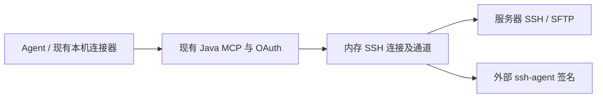

# 远程运维 MCP 实施方案 V3

## 1. 定位与架构

MCP 提供 Agent 到服务器的 SSH 连接通道。Agent 负责命令、排障、部署、后台进程管理、恢复和业务结果判断。



复用 Java 17、Spring Boot、MCP Dispatcher、OAuth 和本机 Rust 连接器。SSH 客户端使用 SSHJ 0.41.0 的 exec、PTY、SFTP 和 Unix socket agent 能力。

服务器目录及账号权限来自 `mcp.remote` 受控配置；连接、通道和输出缓冲保存在内存。新增能力不使用数据库，不安装目标机程序。

## 2. 身份与权限

- OAuth 使用 `linear-lite:remote`。现有 read/write 授权不包含服务器访问权限。
- 服务器配置包含 target_id、alias、environment、host、port、host_key 和账号列表。
- 账号配置包含 profile_id、login_user、public_key_path、agent_socket、allowed_user_ids、max_ttl_seconds。
- Agent 选择 target_id、profile_id。host、登录账号、主机公钥和签名 socket 由服务端配置决定。
- ssh-agent 持有私钥。MCP 读取配置公钥，从指定 agent 中选择匹配身份进行认证；私钥和密码不作为工具参数或返回字段。
- 每次调用核对认证用户、连接所有者、目标账号权限和连接期限。关闭或到期的连接释放通道。
- 远端操作范围由账号及其提权权限决定。root 授权包含读取业务配置与业务凭据的能力。

控制服务运行于支持 Unix domain socket 的 Linux 或 macOS。SSH 使用固定主机公钥校验、指定身份认证；不加载 SSH 用户配置，不启用密码、agent forwarding 或端口转发。

## 3. 工具契约

工具沿用现有 MCP 返回结构：`structuredContent` 为下表的数据对象；工具失败使用 `isError` 和受控错误信息。所有字段名区分大小写，参数对象拒绝未知字段。

| 工具 | 参数 | 返回数据 |
| --- | --- | --- |
| `list_targets` | `{}` | `{targets:[{target_id,alias,environment,profiles:[{profile_id,login_user,max_ttl_seconds}]}]}` |
| `open_session` | `{target_id,profile_id,ttl_seconds}` | `{session_id,target_id,profile_id,login_user,expires_at}` |
| `close_session` | `{session_id}` | `{closed:true}` |
| `exec` | `{session_id,command,pty,rows?,cols?}` | `{session_id,channel_id}` |
| `read_output` | `{session_id,channel_id,after_seq,max_bytes,wait_ms}` | `Output` |
| `write_stdin` | `{session_id,channel_id,action}` | `{sent:true}` |
| `upload` | `{session_id,remote_path,offset,data_base64,truncate}` | `{bytes_written,next_offset}` |
| `download` | `{session_id,remote_path,offset,max_bytes}` | `{data_base64,next_offset,eof}` |

标识符是连接或通道句柄，不是执行任务。`command` 原文作为 SSH exec 请求发送；工作目录、环境变量和 shell 由 Agent 在命令中表达。需要交互 shell 时，Agent 可以提交 `/bin/sh` 并启用 PTY。

`pty` 为必填布尔值；启用时 rows、cols 必填，范围 1–1000；关闭时禁止尺寸字段。command 上限为 1 MiB UTF-8，禁止 NUL。

```ts
type Output = {
  session_id: string;
  channel_id: string;
  chunks: Array<{seq: number; stream: "stdout" | "stderr" | "pty"; data_base64: string}>;
  next_seq: number;
  first_available_seq: number;
  truncated: boolean;
  eof: boolean;
  exit_status: number | null;
  exit_signal: string | null;
  channel_open: boolean;
  transport_error: boolean;
};

type InputAction =
  | {kind: "data"; data_base64: string}
  | {kind: "eof"}
  | {kind: "resize"; rows: number; cols: number}
  | {kind: "signal"; signal: "INT" | "TERM" | "KILL" | "HUP" | "QUIT" | "USR1" | "USR2"}
  | {kind: "close"};
```

输出序号从 1 开始；首次读取使用 `after_seq:0`，后续使用返回的 next_seq。每通道输出缓冲容量为 1 MiB，超量移除旧块，并通过 first_available_seq、truncated 表达缺口。读取不消耗其他读取者的位置。

max_bytes 范围为 16–256 KiB，wait_ms 范围为 0–20000。eof 表示两路流结束且读取位置抵达缓冲末尾；退出信息可能为空。channel_open 表示 SSH 通道是否保持打开。输出 EOF 先于退出信息到达时，Agent 可通过带 wait_ms 的读取等待通道关闭或退出信息；通道关闭不构成业务成功结论。transport_error 表示输出流读取失败，不构成业务失败结论。

data 输入上限为 64 KiB；resize 需要 PTY。signal 应答表示发送请求，服务器是否接受及进程是否结束需由 Agent 核对。close 释放 SSH 通道及缓冲；close_session 释放整个连接。断开连接不承诺远端进程停止。

## 4. 文件传输

文件内容按 offset 经 SFTP 传输，每块上限 256 KiB，使用规范 Base64。remote_path 是远端绝对路径；接口不接受本机文件路径，也不在 MCP 服务端解释 Agent 的本机路径。

upload 的 truncate 为必填布尔值，只有 offset=0 时允许为 true。调用在指定位置写入字节，返回确认写入长度；创建、覆盖、分块顺序及重试由 Agent 决定。接口不提供文件冻结、原子发布或业务回滚语义。

download 从指定位置读取字节。它不创建快照，文件变化的一致性由 Agent 处理。本机文件读取和落盘使用 Agent 的文件工具。

## 5. 连接生命周期

连接期限在打开时确定，受账号 max_ttl_seconds 约束，上限 8 小时。连接和认证使用网络超时；该超时不作为远端命令期限。Agent 如需限制命令时长，使用服务器的命令能力。

每用户上限 4 个连接，服务上限 32 个连接；每连接上限 8 个通道，服务上限 32 个通道。Agent 读取退出输出后使用 close 释放通道。

SSH 断开或服务重启后，句柄失效；MCP 不重建连接、不重发命令、不恢复输入位置、不保存历史输出。需要核对后台进程时，由 Agent 建立连接并检查服务器事实。

MCP 不包含任务模型、任务队列、调度、Worker、租约、执行账本、制品中心或目标机 Runtime。部署、断线恢复、进程终止和业务成功判断属于 Agent。

## 实施事项清单

- 复用 MCP 与 OAuth 入口。
- 接入 SSH 与 SFTP 通道。
- 使用 ssh-agent 托管身份。
- 配置账号权限与连接期限。
- 删除旧任务平台实现。
