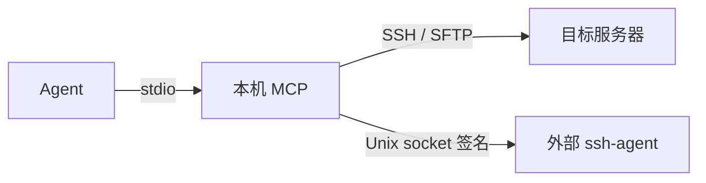

# 远程运维 MCP 实施方案 V4

## 1. 部署与职责



本机 MCP 使用 Node.js 22、官方 MCP TypeScript SDK 与 ssh2，代码位于 `remote-terminal-mcp/`。Agent 启动 MCP 子进程，通过 stdio 调用工具；目标服务器提供 SSH、SFTP。

Agent 承担命令选择、排障、部署、进程管理、恢复及业务结果判断。MCP 提供连接、终端输入输出和文件传输。系统不依赖 Linear Lite 服务、OAuth、数据库、HTTP 入口、任务队列、Worker、制品中心或目标机 Runtime。

## 2. 配置与身份

启动参数为 `--config /绝对路径/targets.json`，配置在进程启动时读取。JSON 根对象为 targets 数组：

```ts
type Configuration = {
  targets: Array<{
    target_id: string;
    alias: string;
    environment: string;
    host: string;
    port: number;
    host_key: string;
    profiles: Array<{
      profile_id: string;
      login_user: string;
      public_key_path: string;
      agent_socket: string;
      max_ttl_seconds: number;
    }>;
  }>;
};
```

配置文件定义该进程可连接的目标与身份。本机 OS 文件权限构成配置授权边界，不设置用户 ID、登录页面或令牌体系。工具不接收 host、账号、主机公钥、签名 socket 或私钥覆盖参数。

host_key 使用经核对的完整 OpenSSH 公钥文本。public_key_path 指向公钥文件，agent_socket 指向外部 ssh-agent 的 Unix socket，路径均为绝对路径。私钥由 ssh-agent 保管；配置和工具不接收密码或私钥。agent 身份列表按配置公钥过滤，签名请求限定该身份；不启用 agent forwarding 或端口转发。

配置不展开环境变量、不读取 SSH 用户配置、不使用其他身份回退。远端操作范围由登录账号及其提权权限决定。root 权限包含读取目标机业务配置与凭据的能力。

## 3. 工具契约

协议使用 MCP `2026-07-28`，stdout 用于协议消息，诊断进入 stderr。八个工具提供严格参数和返回 schema，拒绝未知字段。

| 工具 | 参数 | 返回 |
| --- | --- | --- |
| `list_targets` | `{}` | `{targets:[{target_id,alias,environment,profiles:[{profile_id,login_user,max_ttl_seconds}]}]}` |
| `open_session` | `{target_id,profile_id,ttl_seconds}` | `{session_id,target_id,profile_id,login_user,expires_at}` |
| `close_session` | `{session_id}` | `{closed:true}` |
| `exec` | `{session_id,command,pty,rows?,cols?}` | `{session_id,channel_id}` |
| `read_output` | `{session_id,channel_id,after_seq,max_bytes,wait_ms}` | `Output` |
| `write_stdin` | `{session_id,channel_id,action}` | `{sent:true}` |
| `upload` | `{session_id,remote_path,offset,data_base64,truncate}` | `{bytes_written,next_offset}` |
| `download` | `{session_id,remote_path,offset,max_bytes}` | `{data_base64,next_offset,eof}` |

session_id 与 channel_id 是内存中的 SSH 句柄。command 原文交给 SSH exec；工作目录、环境变量、shell 和运行期限由 Agent 在命令中表达。command 上限 1 MiB UTF-8，禁止 NUL。pty 为必填布尔值，true 时 rows、cols 必填且范围为 1–1000；false 时禁止尺寸字段。

```ts
type Output = {
  session_id: string;
  channel_id: string;
  chunks: Array<{seq: number; stream: "stdout" | "stderr" | "pty"; data_base64: string}>;
  next_seq: number;
  first_available_seq: number;
  truncated: boolean;
  eof: boolean;
  exit_status: number | null;
  exit_signal: string | null;
  channel_open: boolean;
  transport_error: boolean;
};

type InputAction =
  | {kind: "data"; data_base64: string}
  | {kind: "eof"}
  | {kind: "resize"; rows: number; cols: number}
  | {kind: "signal"; signal: "INT" | "TERM" | "KILL" | "HUP" | "QUIT" | "USR1" | "USR2"}
  | {kind: "close"};
```

输出序号从 1 开始，读取起点为 after_seq=0，后续使用 next_seq。读取不消耗其他读取者的位置。每通道保留 1 MiB 输出，超量移除旧块，通过 first_available_seq 和 truncated 表达缺口。max_bytes 范围为 16–256 KiB，wait_ms 范围为 0–20000。

eof 表示输出流结束且读位置抵达缓冲末尾。退出信息可以为空；channel_open 表达 SSH 通道是否开放。输出 EOF 先于退出信息到达时，带 wait_ms 的读取等待通道事实变化或期限结束。通道关闭、退出码和 signal 应答不构成业务成功或远端进程停止的保证。

data 输入使用规范 Base64，上限 64 KiB，内容须非空。resize 要求 PTY。close 释放通道与缓冲，close_session 释放连接及全部通道。

## 4. 文件传输

remote_path 是远端绝对路径。upload、download 使用规范 Base64 按 offset 分块，单块上限 256 KiB。offset 范围为 0 至 `Number.MAX_SAFE_INTEGER - 262144`，保证返回位置能用 JSON 安全整数表达。

upload 的 truncate 为必填布尔值，只有 offset=0 时允许为 true；空 Base64 支持创建或截空文件。接口返回确认写入的字节数，不承诺原子发布、文件快照或操作去重。Agent 决定分块顺序、覆盖、核对与重试策略。

Agent 的本机文件由自身文件工具读取或落盘，MCP 不解释本机文件路径为远端路径。

## 5. 连接生命周期

连接 TTL 在打开时确定，受 profile.max_ttl_seconds 约束，上限 8 小时。服务上限 32 个连接，每连接上限 8 个通道，进程上限 32 个通道。Agent 读取结束信息后释放通道。

连接、认证、通道打开及 SFTP 请求使用网络等待期限，不将网络期限作为远端命令时限。连接到期、SSH 断开、stdin EOF 或 MCP 进程退出会释放连接资源；句柄不跨进程保存。

MCP 不重连、不重发命令、不重建通道、不恢复历史输入或输出。网络失败时返回受控错误；命令、输入或文件变更是否发生，由 Agent 连接服务器核对。

## 实施事项清单

- 提供独立 stdio 启动入口。
- 读取本机目标与身份配置。
- 接入 SSH 与 SFTP。
- 使用外部 agent 签名。
- 移除 Java 与 OAuth 接线。
