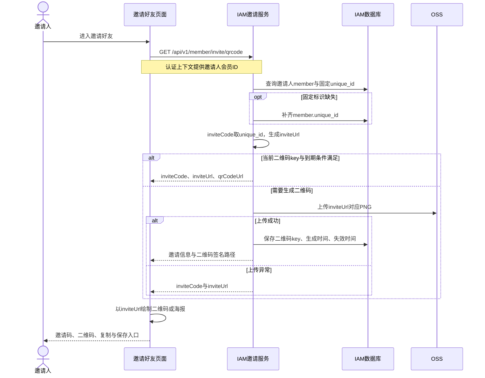
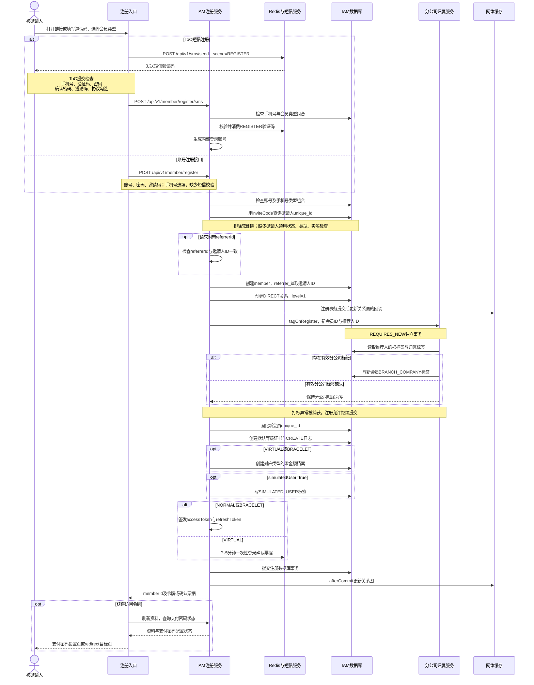
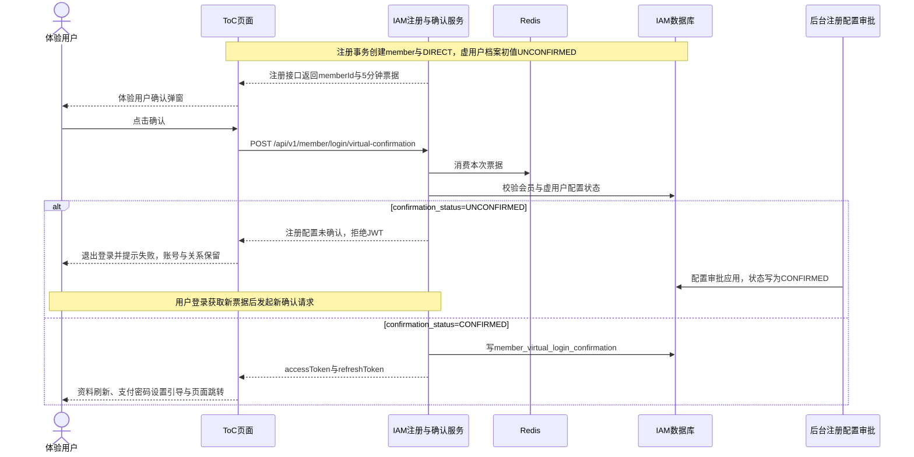

# 注册业务梳理 v2

日期：2026-10-04。依据：ToC 前端、IAM 服务源码与建表脚本。本文描述代码现状；部署配置、生产数据、短信与页面运行结果缺少本次验证。历史版本：[邀请注册细节梳理 v1](../邀请注册细节梳理-v1.md)。

## 1. 名词解释

| 名词 | 含义 | 字段或业务边界 |
| --- | --- | --- |
| 会员账号 | 平台中的账户主体 | `member.id` 是会员主键；同一手机号的不同类型账号拥有不同 ID |
| 登录账号 | 账号密码注册时填写，短信注册时由服务生成 | `member.account`；短信账号取 `m + 手机号 + UUID前2位`，生成尝试上限 10 次 |
| 手机号 | 短信接收号码、登录定位条件 | `member.mobile`；同手机号同类型禁止重复注册，不同类型允许建号 |
| 会员类型 | 注册确定的账号类型 | `NORMAL` 普通用户、`VIRTUAL` 体验用户、`BRACELET` 手镯用户；省略时取 `NORMAL` |
| 固定业务标识 | 会员业务标识 | `member.unique_id`；与会员 ID、手机号、完整证书号含义不同 |
| 邀请码／星推码 | 邀请人的固定业务标识 | `inviteCode → 邀请人member.unique_id → 邀请人member.id`；码内容缺少区域、分公司、祖先关系快照 |
| 邀请链接 | 携带邀请码的注册链接 | 默认路由 `/pages/common/register/index?inviteCode={inviteCode}`；二维码内容为该 URL |
| 邀请二维码 | 邀请链接的图像表达 | IAM保存OSS对象key；前端使用 `inviteUrl` 绘制二维码；图片缓存期限与邀请码有效性分开 |
| 短信验证码 | 证明短信接收能力的一次性凭据 | `scene=REGISTER`，Redis按场景与手机号保存；与邀请码含义不同 |
| 直接上级／推荐人 | 邀请码定位的邀请人账号 | 新会员 `member.referrer_id` 和关系记录 `parent_id` 指向邀请人 ID |
| 网体／DIRECT关系 | 推荐树的父子关系 | `member_relation` 保存 `member_id → parent_id` 的一条 `DIRECT` 边；祖先与下级由关系图展开 |
| 分公司根账号 | 后台指定的分公司网体起点 | `member_tag.tag_key=BRANCH_COMPANY_ROOT`，`tag_value=分公司名称` |
| 分公司归属 | 会员所属分公司 | `member_tag.tag_key=BRANCH_COMPANY`；注册继承推荐人的有效标签；全量重算按最近分公司根账号归属 |
| 实名地区 | 会员实名资料中的行政区编码 | `member_realname.region_code` 来自身份证号前六位；注册分公司计算没有读取该字段 |
| 默认等级证书 | 注册创建的会员等级数字证书 | `member_certificate.cert_type=MEMBER_LEVEL`，等级取配置，默认 1；创建动作写 `member_certificate_log` |
| 模拟用户标签 | 注册请求的模拟来源标记 | `simulatedUser=true → member_tag.SIMULATED_USER=true`；标签与 `member_type` 分开 |
| 虚用户注册配置审批 | 确认虚用户经济档案与登录资格的后台业务 | `member_virtual_profile.confirmation_status` 初值 `UNCONFIRMED`，审批应用后为 `CONFIRMED` |
| 虚用户登录确认 | 用户确认本次登录的动作 | 消费5分钟票据，校验配置状态，成功后写审计记录并签发JWT；缺少修改注册配置状态的动作 |
| 登录密码／支付密码 | 登录凭据与资产操作凭据 | 注册写入登录密码哈希；支付密码属于后续设置，页面对缺少支付密码的账号提供引导 |
| 注册来源 | 请求记录的入口标记 | `member.register_source`；ToC注册页提交 `TOC_H5` |

名词依据：[注册服务](../../../iam-service/src/main/java/org/zhongchengshulian/easygobackendapi/service/iam/MemberService.java#L107)、[邀请码解析](../../../iam-service/src/main/java/org/zhongchengshulian/easygobackendapi/service/iam/MemberService.java#L859)、[分公司规则](../../../iam-service/src/main/java/org/zhongchengshulian/easygobackendapi/service/iam/BranchCompanyService.java#L109)、[实名地区](../../../iam-service/src/main/java/org/zhongchengshulian/easygobackendapi/service/iam/RealnameService.java#L110)、[证书与日志](../../../iam-service/src/main/java/org/zhongchengshulian/easygobackendapi/service/iam/CertificateService.java#L121)。

分公司继承规则：推荐人有有效根标签时取根标签名称；缺少有效根标签时取有效归属标签名称；两者缺失时归属为空。有效标签要求 `status=1`、名称非空。甲分公司根账号 A 邀请 B，B 邀请 C，B、C 归甲分公司；后台将 B 设置为乙分公司根账号并重算后，B及其下级归乙分公司。[最近根算法](../../../iam-service/src/main/java/org/zhongchengshulian/easygobackendapi/service/iam/BranchCompanyService.java#L169)

## 2. 时序图

### 2.1 邀请信息生成

查看时序图源码

二维码对象key包含年份与链接指纹；失效时间为生成年份下一年的12月31日23:59:59。邀请码注册查询缺少二维码到期检查。邀请码标识补齐存在历史证书回读分支，二维码URL存在旧字段读取分支，属于单一数据路径规则的现状冲突。[邀请服务](../../../iam-service/src/main/java/org/zhongchengshulian/easygobackendapi/service/iam/InviteQrCodeService.java#L67)、[固定标识补齐](../../../iam-service/src/main/java/org/zhongchengshulian/easygobackendapi/service/iam/CertificateService.java#L321)、[邀请页面](../../../front/uni-zhongchengshulian-toc/src/pages/Invitation/index.vue#L197)

### 2.2 公开注册、网体建立与分公司归属

查看时序图源码

数据库事务包围账号检查和注册写入；短信消费发生在Redis，数据库回滚缺少短信恢复动作。邀请码错误发生在短信消费之后，重试需要新验证码。分公司打标使用独立事务，注册成功不等于分公司标签写入成功。注册没有推荐人资产发放、佣金、分红、入池调用。[注册实现](../../../iam-service/src/main/java/org/zhongchengshulian/easygobackendapi/service/iam/MemberService.java#L201)、[短信消费](../../../iam-service/src/main/java/org/zhongchengshulian/easygobackendapi/service/iam/SmsService.java#L249)、[独立打标](../../../iam-service/src/main/java/org/zhongchengshulian/easygobackendapi/service/iam/BranchCompanyService.java#L108)

邀请码输入框可编辑，提交值决定推荐人。页面读取 `inviteCode/code/shareCode` 与多个扫码入口字段，响应 `memberId` 存入前端 `user_id`，与单一数据路径规则冲突。协议勾选与确认密码属于页面条件，注册DTO缺少协议同意记录字段。资料刷新或后续确认失败发生在注册API返回后，页面失败提示不能作为会员不存在的依据。[注册页面](../../../front/uni-zhongchengshulian-toc/src/pages/common/register/index.vue#L207)、[注册字段](../../../iam-service/src/main/java/org/zhongchengshulian/easygobackendapi/dto/iam/SmsRegisterReq.java#L22)

### 2.3 体验用户的注册配置与登录确认

查看时序图源码

初始 `UNCONFIRMED` 与页面登录确认要求 `CONFIRMED` 形成链路阻断。后台配置审批与本次登录确认是两个业务动作；登录确认不会把配置状态改为 `CONFIRMED`。取消弹窗缺少删除会员或推荐关系的调用。[档案初值](../../../iam-service/src/main/java/org/zhongchengshulian/easygobackendapi/entity/iam/MemberVirtualProfile.java#L222)、[登录确认](../../../iam-service/src/main/java/org/zhongchengshulian/easygobackendapi/service/iam/VirtualLoginConfirmationService.java#L71)、[审批应用](../../../iam-service/src/main/java/org/zhongchengshulian/easygobackendapi/service/internal/VirtualRegistrationConfirmationService.java#L395)

管理端建号属于独立入口，使用 `referrerId`，允许无上级账号；管理端换绑更新推荐关系并触发提交后的分公司重算。网体流水聚合时点为上海时间11:00、14:00、18:00，关系更新与流水展示存在时间差。[管理建号](../../../iam-service/src/main/java/org/zhongchengshulian/easygobackendapi/service/internal/AdminMemberService.java#L1147)、[换绑](../../../iam-service/src/main/java/org/zhongchengshulian/easygobackendapi/service/internal/AdminMemberService.java#L563)、[流水聚合](../../../iam-service/src/main/java/org/zhongchengshulian/easygobackendapi/service/iam/MemberNetworkFlowAggregationScheduler.java#L57)

## 3. 数据落库图谱

图中 `A` 表示邀请人ID，`B` 表示新会员ID，`C` 表示证书ID，`X` 表示分公司名称。连线表达逻辑字段关联，数据库外键约束不在图中声明。绿色为既有数据读取，蓝色为注册数据库事务，橙色为分公司独立事务，紫色为后续登录确认。

| 写入阶段 | 表 | 核心内容 | 创建条件 |
| --- | --- | --- | --- |
| 注册事务 | `member` | `id=B`、`referrer_id=A`、新会员`unique_id`、账号、手机号、密码哈希、类型、来源 | 公开注册成功 |
| 注册事务 | `member_relation` | `member_id=B`、`parent_id=A`、`DIRECT`、`level=1` | 邀请人存在，建立直推关系 |
| 注册事务 | `member_certificate` | `id=C`、`member_id=B`、`MEMBER_LEVEL`、默认等级、新会员固定标识 | 新会员的默认等级证书创建 |
| 注册事务 | `member_certificate_log` | `member_id=B`、`cert_id=C`、`action=CREATE`、证书号变化 | 证书创建成功 |
| 注册事务 | `member_virtual_profile` | `member_id=B`、金额初值0、`confirmation_status=UNCONFIRMED` | 类型为`VIRTUAL` |
| 注册事务 | `member_bracelet_profile` | `member_id=B`、金额初值0、`configuration_status=UNCONFIGURED` | 类型为`BRACELET` |
| 注册事务 | `member_tag` | `member_id=B`、`SIMULATED_USER=true`、`status=1` | 请求`simulatedUser=true` |
| 分公司独立事务 | `member_tag` | `member_id=B`、`BRANCH_COMPANY`、名称`X`、`status=1` | 推荐人存在有效分公司标签，写入成功 |
| 后续登录确认 | `member_virtual_login_confirmation` | `member_id=B`、登录方式、发起IP、确认IP、确认时间 | 配置为`CONFIRMED`，本次票据确认成功 |

推荐人 `member` 与其分公司标签属于读取数据；不会因新会员注册而新增推荐人记录。虚用户档案与手镯档案为互斥的类型分支，模拟标签由请求布尔值决定。

Redis操作与数据库写入分开：短信验证码校验后删除，虚用户票据有效期5分钟，关系缓存更新发生在事务提交后。邀请信息生成会更新邀请人的二维码缓存字段，属于2.1的邀请接口；这些字段不属于被邀请人注册时的写入集合。

实名资料、支付密码配置、资产领取、团队等级结算属于后续业务。公测领券要求活动资格、注册时间、实名和支付密码，发放对象是新会员；注册接口缺少邀请人奖励调用。手机号与类型的服务唯一性查询排除软删除，数据库唯一索引包含软删除行，历史账号占用可能导致数据库拒绝。

落库依据：[会员、标签与类型档案建表](../../../iam-service/src/main/resources/iam_schema.sql#L10)、[关系建表](../../../iam-service/src/main/resources/iam_schema.sql#L227)、[证书与日志建表](../../../iam-service/src/main/resources/iam_schema.sql#L695)、[证书日志写入](../../../iam-service/src/main/java/org/zhongchengshulian/easygobackendapi/service/iam/CertificateService.java#L405)、[类型档案初始化](../../../iam-service/src/main/java/org/zhongchengshulian/easygobackendapi/service/iam/MemberService.java#L910)、[手镯档案初值](../../../iam-service/src/main/java/org/zhongchengshulian/easygobackendapi/entity/iam/MemberBraceletProfile.java#L129)、[登录审计建表](../../../iam-service/src/main/resources/iam_schema.sql#L191)、[公测领取资格](../../../iam-service/src/main/java/org/zhongchengshulian/easygobackendapi/service/iam/PublicTestAssetGrantService.java#L87)。

图谱使用内置 imagegen 生成。可追溯提示词：[生成提示词](数据落库图谱生成提示词.txt)、[连线修订提示词](数据落库图谱连线修订提示词.txt)、[关联修订提示词](数据落库图谱关联修订提示词.txt)。
