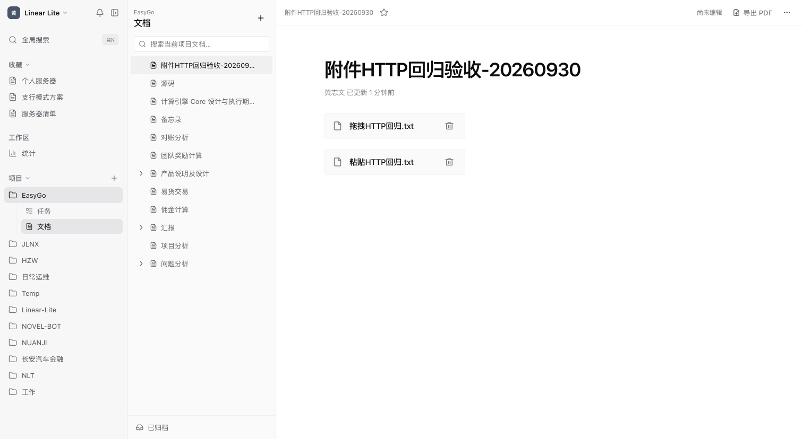

# 文档附件 HTTP 回归交付记录 V1

日期：2026-09-30

## 故障与修复

生产页面使用 `http://124.223.84.101:9080`。该页面的 `isSecureContext` 为 `false`，浏览器提供 `crypto.getRandomValues`，不提供 `crypto.randomUUID`。

附件优化引入的两处 `crypto.randomUUID()` 调用分别位于粘贴占位块创建和上传队列创建。异常发生在上传请求之前，导致拖拽与粘贴无法上传。原验收使用 localhost，遗漏了公网 HTTP 的浏览器 API 条件。

两处调用改为项目的 `randomClientId()`。复用现有 ID 工具，不增加字段映射或上传数据路径。

## 验证证据

| 层次 | 结果 |
| --- | --- |
| 上传队列回归 | 模拟缺少 `randomUUID` 的环境；修复前出现 TypeError，修复后触发上传并返回链接 |
| 编辑器粘贴回归 | 挂载 React BlockNote 编辑器，派发文件粘贴事件；旧调用无法触发上传，修复后渲染附件链接 |
| 前端相关测试 | 5 个测试文件、30 项测试通过 |
| 前端编译 | `vue-tsc` 与 Vite 构建通过 |
| 发布包 | Maven package 通过；JAR 内的首页与本地 dist 一致 |

浏览器验收使用 `http://192.168.225.29:5173` 的修复版前端，代理至生产后端。页面的 `isSecureContext=false`、`crypto.randomUUID=undefined`。验收代理的 Origin 使用目标站点 Origin；产品 CORS 配置未变更。

在验收文档 587 中，向编辑器派发含 File 的 ClipboardEvent 与 DragEvent，使用产品处理函数及生产上传服务，生成附件记录 934、935。浏览器文件事件验收不覆盖操作系统原生文件拖拽与剪贴板权限。

| 入口 | 文件 | 下载内容 | 结果 |
| --- | --- | --- | --- |
| 粘贴 | 粘贴HTTP回归.txt | `HTTP paste verification`（23 字节） | 上传卡片结束，链接写入正文；刷新后保留，下载字节匹配 |
| 拖拽 | 拖拽HTTP回归.txt | `HTTP drop verification`（22 字节） | 文件块写入正文；刷新后保留，下载字节匹配 |

上述流程使用生产数据库及 R2 存储。用户文档 585 未修改。本次修复为前端 ID 创建逻辑；80 MiB 上传的存储链路证据见上一份附件上传交付记录。

## 验收数据清理

文档 587 的正文清空为 BlockNote JSON 数组 `[]`，附件 934、935 经产品删除接口清除，附件列表为 `[]`。文档归档时间为 `2026-09-30T13:24:00+08:00`，版本为 6。验收浏览器空间关闭。

## 发布状态

发布包：`linear-lite-server/target/linear-lite-server-0.1.0-SNAPSHOT.jar`

SHA-256：`d6db18b3ad740f638424137dd33a183d10326800ed28e374016d0eadc744bb56`

生产部署入口的 SSH 登录返回 `Permission denied (publickey,password)`。生产前端未发布修复版；交付包及 HTTP 回归证据完成，发布需要可用的部署入口。
