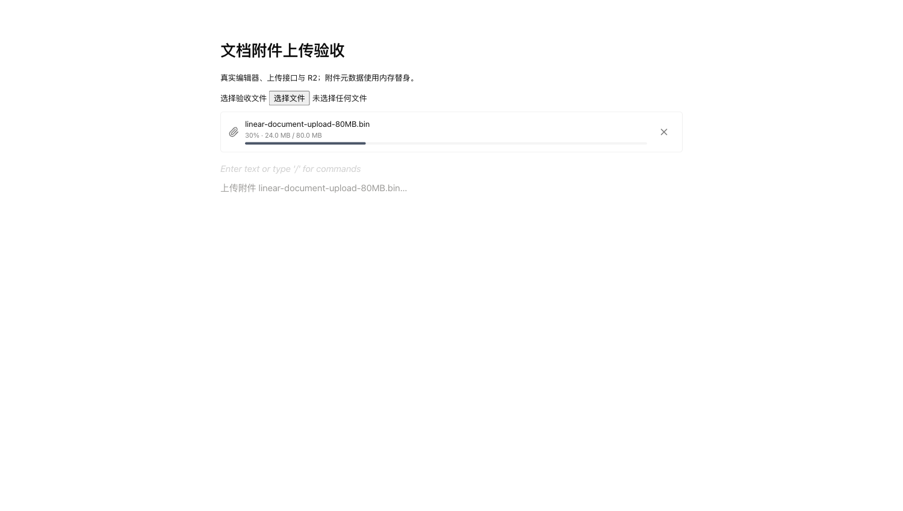
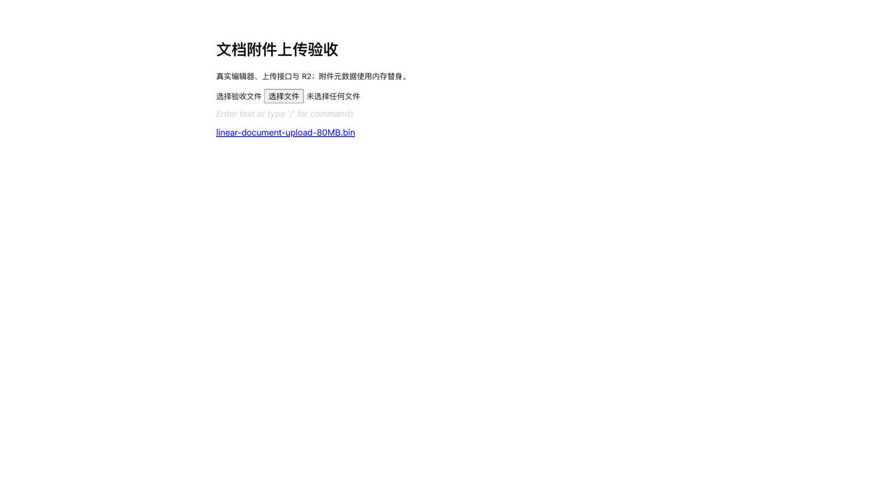
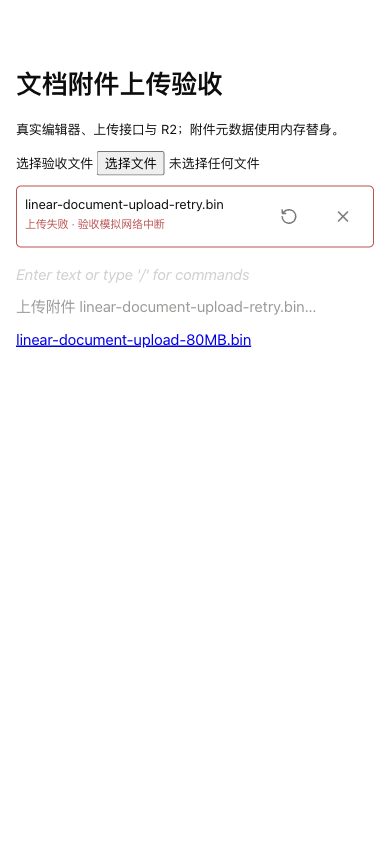

# 文档附件分片上传交付记录 V1

日期：2026-09-30

## 交付行为

- 文档文件和图片使用同一个上传会话接口；8MiB 分片、3 路并发。
- 上传卡片显示百分比、已传大小、重试状态、校验保存状态，提供取消和失败重试。
- 重试读取 R2 的分片清单，补传缺失分片；确认请求复用会话，避免重复附件记录。
- 服务端收到的分片写入临时缓存。完成 R2 合并后，核对对象大小、会话身份和 multipart ETag，计算整文件 SHA-256。缓存丢失时使用 R2 对象重建校验内容。
- 网络传输、哈希计算和图片分析在附件入库事务之外；入库使用项目写锁和会话 sourceId。
- 正文排除上传占位文字；成功确认后写入附件链接或图片资源 ID。
- 会话有效期为 24 小时；每小时清理过期分片、未入库对象和分片缓存。

R2 的 multipart ETag 由各分片 MD5 的二进制拼接生成，并带分片数。它用于核对缓存与存储对象，整文件 SHA-256 使用原始字节计算。[Cloudflare 官方说明](https://developers.cloudflare.com/r2/objects/upload-objects/)

## 验收结果

环境：真实浏览器、真实编辑器、真实 JWT 过滤器、真实 HTTP 上传接口、真实 R2；文档与附件 Mapper 使用内存替身，项目成员权限守卫使用测试替身。

| 场景 | 证据 |
| --- | --- |
| 旧链路基线 | 80MiB 请求等待 120 秒后由客户端取消；服务端生成了同文件附件记录，验收附件完成删除 |
| 新链路 80MiB 上传 | 83,886,080 字节；62.732 秒完成附件登记；10 个分片各上传一次；正文生成附件链接 |
| 故障重试 | 16MiB+7 字节；第 2 片注入三次 503；R2 保留第 1、3 片；用户重试补传第 2 片，正文生成附件链接 |
| 取消 | 上传阶段点击取消后，卡片及正文占位块移除；会话查询返回 404，R2 分片会话终止 |
| 图片 | 29,970 字节 PNG；1024×1024；缩略图生成；正文保存 documentImage.imageAssetId；浏览器图片加载成功 |
| 窄屏 | 390px；失败状态、重试与取消按钮可用，无横向溢出；移动端按钮为 44px |
| 清理 | 验收附件及其存储对象删除，附件列表为 0；分片缓存目录为空；验收浏览器空间关闭 |

文件 SHA-256 与服务端登记值一致：

| 文件 | SHA-256 |
| --- | --- |
| 80MiB 文件 | `353cad6a93e6f1efac3bd800abf48482d775fbc308b87d34591f5b212c1dd4b4` |
| 重试文件 | `40713e38f1818cdc78cc980d912bd3c105c73e59d9bdf55143cd506add61fdcd` |
| PNG | `dea6509ce5413207f0eda5da28e8e0ae8c58f35ddbe33de5c8a5d4b3c82342a4` |

## 编译与回归

- 前端类型检查和 Vite 构建通过。
- 前端 6 个相关测试文件、36 项测试通过。
- 后端编译、测试编译通过；附件服务、分片服务、分片缓存的 22 项测试通过。
- 分片缓存测试覆盖：复用分片核对 R2 ETag、缓存损坏拒绝确认并清除缓存、缓存丢失从对象重建。
- 分片服务测试覆盖：会话用户及文档绑定、登录令牌隔离、大小限制、缺失与错误分片、输入内容重放、确认响应丢失、对象大小不一致拒绝入库。
- impeccable 检测和浏览器检查完成。新卡片复用设计令牌；检测发现 StructuredDocumentEditor 既有 15px 字号偏离 DESIGN.md，属于本次变更之外的样式。

## 验证边界与权衡

- 生产部署和真实数据库联调待完成。当前配置的数据库端口拒绝连接；本次没有执行数据库操作。
- 62.732 秒为本次网络条件下的上传结果，不是性能承诺。
- 文件和上传会话保留在当前编辑器打开期间，页面刷新后的文件重选续传界面没有交付。
- 分片缓存使用服务端临时磁盘，单文件缓存占用与文件大小一致；成功、取消和过期清理负责释放。
- 文档网页编辑器使用新分片接口。旧整文件接口服务于迁移脚本和 MCP 上传调用，二者不是网页编辑器的兼容回退路径。
- 添加 `@tiptap/pm@3.22.3` 根依赖，与 BlockNote 的 Tiptap 版本一致，解决干净依赖安装后的编辑器构建缺失问题；npm 和 pnpm 锁文件同步。

## 验收入口

- `docs/验收/文档附件上传验收.html`：挂载产品编辑器，文件选择后派发粘贴事件。
- `DocumentUploadAcceptanceServer`：测试代码中的验收服务，默认端口 19080。使用现有环境配置连接 R2，业务 Mapper 为内存替身，故障控制端点不会加载到产品应用。
- Vite 代理指向验收服务；接口路径保持 `/api`。图片验收调用 `/api/__acceptance/session` 建立路径级图片 Cookie。
