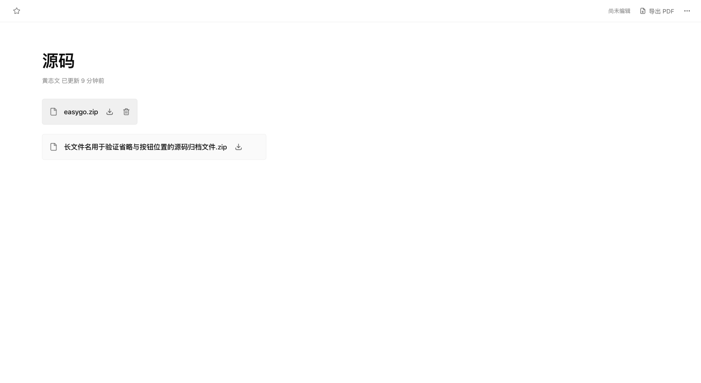

# 附件操作按钮样式与显示规则验收记录 V1

日期：2026-09-30

## 变更

正文附件链接卡片的下载伪元素改为带名称的独立按钮。文件名点击和下载按钮调用同一鉴权下载入口。下载与删除使用 Lucide 图标、设计令牌、焦点描边和加载状态。

| 状态 | 下载 | 删除 |
| --- | --- | --- |
| 桌面默认 | 显示 | 隐藏 |
| 卡片悬停或操作区键盘聚焦 | 显示 | 显示 |
| 触屏 | 显示，44×44 | 显示，44×44 |
| 保存冲突的只读状态 | 显示 | 不渲染 |
| 当前附件请求等待 | 禁用 | 禁用 |

当前附件下载或删除时，发起操作的按钮显示加载图标。等待集合按附件 ID 管理，阻止同一附件重复操作。操作区放在正文外的 overlay；正文节点及附件字段链路不增加映射。卡片尺寸变化时更新定位，避免触屏尺寸切换后按钮覆盖文件名。PDF 打印隐藏操作区。

## 验证

- 5 个测试文件、21 项测试通过，覆盖按钮下载、重复请求阻止、只读删除隐藏、鉴权下载拦截、删除失败、标题键盘及 PDF 回归。
- 前端类型检查、Vite 构建与 Maven 发布包构建通过。
- 浏览器使用产品 DocumentEditor、StructuredDocumentEditor 和 BlockNote；下载及删除接口采用等待状态替身，不请求生产附件。
- 桌面默认删除隐藏，悬停第一张卡片时第一张删除可见、第二张隐藏。Tab 聚焦删除后按钮可见且带焦点描边，Enter 在下载按钮上触发对应附件下载。
- 只读状态显示两个下载按钮，删除按钮数量为 0。
- 390 像素触屏模拟中，四个按钮为 44×44、可见，按钮中心命中对应 button；页面宽度与滚动宽度均为 390，长文件名省略。删除完成后附件链接与对应操作组移除。
- impeccable 检测的三个提示涉及现有收藏颜色和标题字号，本次操作按钮使用设计令牌。

## 发布包

`linear-lite-server/target/linear-lite-server-0.1.0-SNAPSHOT.jar`

SHA-256：`ee0ad6f69b34c53f04806811f902cf8f0d2e032623b7ff41fbd06c5a3431e858`

包内首页与前端构建一致，此包包含之前的附件上传和 HTTP 修复。本次改动的线上发布等待可用部署入口。
