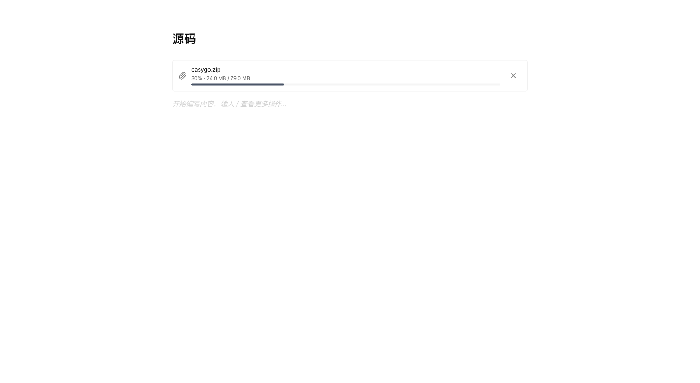

# 附件正文提示精简验收记录 V1

日期：2026-09-30

## 变更

删除粘贴上传时的正文占位块、占位文案参数及无调用的占位块过滤函数。上传进度、失败、重试与取消由附件进度卡片展示，上传完成后在粘贴位置插入附件。插入位置被用户删除时不向其它段落插入附件。

## 验证

- 4 个测试文件、23 项相关测试通过；HTTP 环境测试覆盖上传期间正文不变、完成后附件链接出现。
- 前端类型检查与构建通过，Maven 发布包构建通过。
- 浏览器加载产品编辑器与进度卡片，使用固定进度的上传替身：79 MB 文件在 30% 时显示 `24.0 MB / 79.0 MB`，正文无上传提示或占位块；完成后卡片消失、正文保存附件链接；取消上传不改变正文。此次界面验收不覆盖服务端存储。
- impeccable 检测发现现有颜色和字号与 DESIGN.md 的差异，涉及未变更样式；本次删除正文状态展示未引入样式或控件。

## 发布包

`linear-lite-server/target/linear-lite-server-0.1.0-SNAPSHOT.jar`

SHA-256：`df408a3dd650ff300e8d88935246e5c86bd7c165d0ac7cf0e21729b85e90ad69`

JAR 内首页与本次前端构建一致。此包替代上一份 HTTP 回归记录中的发布包。生产部署等待可用的部署入口。
